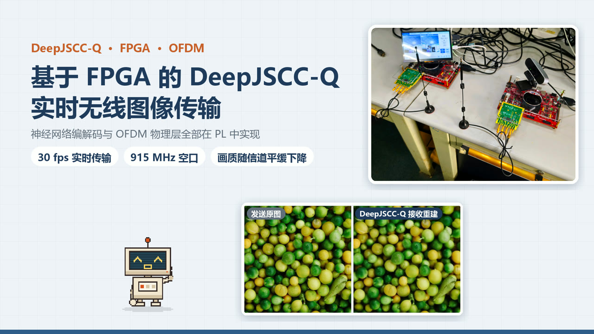
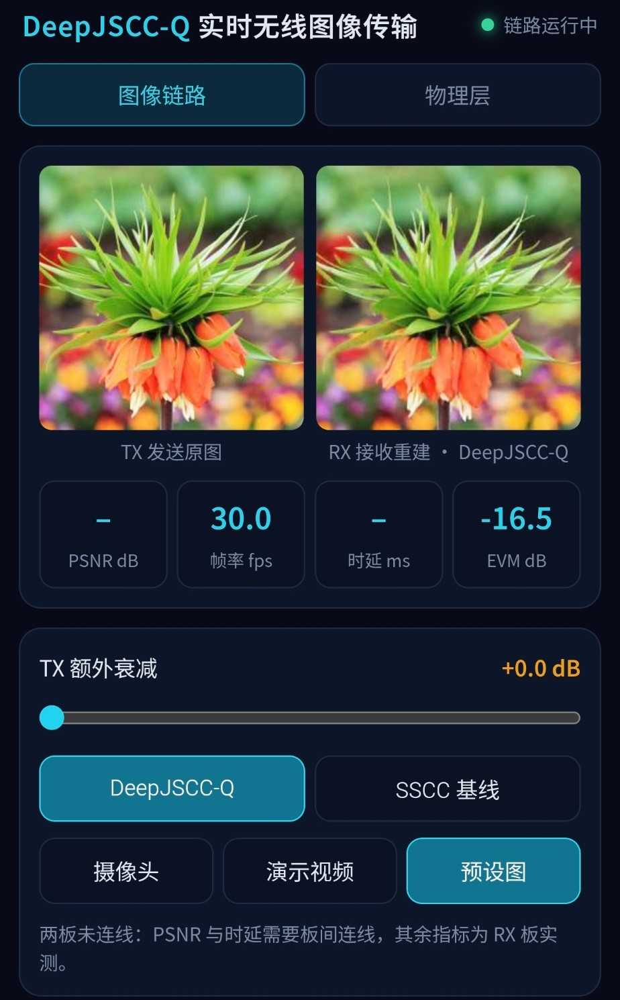

# deepjsccq-ofdm-fpga：基于 FPGA 的 DeepJSCC-Q 实时无线图像传输

两块 PYNQ-ZU（Zynq UltraScale+ xczu5eg）+ 两块 AD9361 射频卡，**深度联合信源信道编码器 / 解码器（DeepJSCC-Q）与类 802.11a OFDM
物理层全部在 PL 中实现**，经 915 MHz 空口以 **30 fps** 实时传输 256×256 彩色图像。信道变差时画质平缓下降，而不是像
"JPEG + 纠错码"那样在某个 SNR 处突然失效。

全国大学生嵌入式芯片与系统设计竞赛 · 2026 FPGA 赛道 · 自主选题（高级组）

<p align="center"><a href="https://www.bilibili.com/video/BV1UDHy6aEp8/"></a></p>

**演示视频**（2.5 分钟，点击图片或[此处](https://www.bilibili.com/video/BV1UDHy6aEp8/)在 B 站观看）：作品概述；SSCC 与 DeepJSCC-Q
逐步加大衰减的实物对比；两个实现难点（把神经网络放进一片 FPGA、长帧的软符号接收）；与已发表 FPGA 实现的对比。演示由 AI 代理按脚本控制两块板卡完成，
画面为相机实拍与触摸屏、代理显示器的同步录屏。

---

## 作品简介

**问题**。传统的图像无线传输先压缩（JPEG）、再加纠错码和调制。这种"分离式"设计在信道 SNR 低于纠错码门限时会突然失效
（悬崖效应），SNR 高于门限时，多出来的信道质量又不能转化为画质。DeepJSCC 用一对神经网络把像素直接映射为信道符号，端到端训练，
画质随 SNR 平缓变化；DeepJSCC-Q 进一步把符号约束到 64-QAM 星座上，使它能接入标准的数字物理层。

**本作品**把这条链路完整地做成了实时运行的 FPGA 系统：

| # | 内容 |
|---|---|
| 1 | **全 PL 实现**：DeepJSCC-Q 编码器 / 解码器（W8A12 整数运算）与 OFDM 物理层都在 PL 中，PS 只负责取图、射频控制和显示；30 fps，PL 内单帧时延 71.5 ms |
| 2 | **面向 FPGA 的网络改造**：保持每幅图 32,768 个信道符号不变，主通道数 256 → 32、下采样 16 → 4 倍，乘加量降为原网络的约 1/51，权重与激活全部放在片上；代价是 Kodak 上 PSNR 约低 1.6 dB |
| 3 | **逐层流水的卷积引擎**：RTL 由生成器自动产生，106 个卷积引擎各按帧率预算选择最小并行度，权重 ROM 按尺寸在 LUT / 宽字 BRAM / 顺序读 + 位宽转换中选择，大激活缓存放入 URAM。卷积工作量是已发表 FPGA 实现 [3] 的 10.5 倍，编码器 DSP 只用其 15 % |
| 4 | **面向长帧软符号的 OFDM 接收机**：一幅图 = 683 个 OFDM 符号；按晶振标称偏差（±20 ppm）的最坏情况设计二阶 SFO 跟踪与 CPE 补偿，帧尾 EVM 只比帧头差约 1.7 dB；均衡后的连续 I/Q 直接送入解码器，不做判决；PN 符号翻转消除网络输出相关性带来的 PAPR 升高 |
| 5 | **同 PHY 空口对比**：SSCC 基线（JPEG + K=7 卷积码 + 64-QAM）与 DeepJSCC-Q 共用同一物理层、同星座电平与 TX 衰减、每幅图同样 32,768 个符号，触摸屏上一键切换 |

## 主要结果（实测，空口）

| 指标 | 结果 | 数据 |
|---|---|---|
| PSNR–SNR（DIV2K 0802） | DeepJSCC-Q：SNR 32 dB 时 32.0 dB，5.5 dB 时仍有 26.5 dB，平缓退化；SSCC 最高 28.2 dB，在 SNR 约 17–20 dB 处悬崖式失效 | `data/measurements/psnr_snr/` |
| 帧率 | 30 fps：连续 600 s 收到 18000 帧 | `data/measurements/fps/` |
| 时延（PL 计数器，中位数） | 编码 38.20 ms / 传输 2.87 ms / 解码 30.39 ms，合计 71.47 ms | `data/measurements/latency/` |
| 资源 / 时序（xczu5eg，布局布线后） | TX：LUT 52,679（45 %）、BRAM36 104.5（73 %）、URAM 10、DSP 243，WNS +0.261 ns；RX：LUT 70,768（60 %）、BRAM36 123.5（86 %）、URAM 25、DSP 394，WNS +0.234 ns | `build/reports/` |
| 功耗（实测，板载 PMBus 遥测） | TX 3.06 W / RX 3.71 W（PL、PS 与 DDR 电源轨，30 fps）；Vivado 估算 4.51 / 4.94 W | `data/measurements/power/`、`build/reports/*_power.rpt` |
| 网络精度 | W8A12 比浮点低 0.05 dB（DIV2K）/ 0.06 dB（Kodak）；RTL 与整数参考模型逐比特一致 | `data/model/`、`sim/network/` |

---

## 系统组成

<p align="center"></p>

左：接收板（PYNQ-ZU + AD9361 + 1024×600 触摸屏）；右：发射板（PYNQ-ZU + AD9361 + USB 摄像头）；两块子卡各接一根 915 MHz 天线。
编码后的图像只经射频空口传输，板间网线仅用于控制和发送原图预览（GUI 计算 PSNR 用）。

<p align="center"></p>

| 参数 | 值 |
|---|---|
| 帧 | 一帧 = 一幅 256×256×3 图 = 32,768 个 64-QAM 符号 = 683 个 OFDM 符号；前导 320 + 683×80 = 54,960 个采样 = 2.748 ms |
| 物理层 | 64 点 FFT，CP 16，48 个数据子载波 + 4 个导频，20 MSPS，915 MHz |
| 网络 | 编码器 55 个、解码器 59 个卷积；387k 参数；名义卷积工作量 0.913 + 1.417 = 2.33 GMAC/帧；每像素 0.5 个复符号 |
| 时钟 | 网络 250 MHz，物理层 100 MHz，二者之间只经过异步 FIFO；AD9361 接口 40 MHz |

## 关键设计

### DeepJSCC-Q 模型

按 Tung 等人 DeepJSCC-Q（IEEE JSAIT 2022）的期刊版结构实现：编码器由残差块（GDN）、注意力块组成，输出 64×64×16 的潜变量，
相邻通道配成 I/Q，量化到 64-QAM 星座；解码器以 PixelShuffle 上采样（IGDN）还原图像。在 10 dB AWGN 下训练，训练目标加入星座分布（KL）
正则；训练后量化为 8 位权重、12 位激活。

为了在单片 xczu5eg 上实时运行，网络规模做了取舍：原网络（主通道 256、下采样 16 倍）的编码器权重就有 10.6 MB，远超片上约 2.95 MB 的存储，
30 fps 所需的乘加量也是全部 DSP 能力的 4.6 倍。本作品把主通道减为 32、下采样减为 4 倍，潜变量仍是 65,536 个元素（信道使用量不变），
乘加量降为原网络的约 1/51、参数量降为约 1/89；与论文同一工作点（Kodak、64-QAM、SNR 10 dB、ρ = 1/6）相比，PSNR 低约 1.6 dB
（33.3 dB 对 34.9 dB，差值也包含训练数据规模的差异）。模型来历、修改与训练流程见 [`src/model/README.md`](src/model/README.md)。

<p align="center"></p>

### 逐层流水的卷积引擎

顶层 RTL 由生成器根据导出的模型文件自动产生。每个卷积层是一个独立引擎：行缓存保存最近几行输入，窗口元素广播到 P 路乘累加，
输出通道分组重读窗口，结果经偏置、激活、重定标后流向下一层；层间全程 AXI-Stream 反压。并行度 P 按"满足 30 fps 的最小值"逐层选择；
权重 ROM 只做顺序读，可以紧凑存放并经位宽转换输出，P 不受 BRAM 端口位宽限制；GDN 用迭代开方与除法，sigmoid 用 32 段分段线性，均不用查找表。

<p align="center"></p>

### OFDM 物理层与射频前端

- **同步**：STF 延迟自相关检测帧并估计 CFO；LTF 匹配滤波定时（Gauss 复数乘法，3 个实数 FIR），门限按"半采样偏移"的最坏情况取 0.375，
  只需移位相加；FFT 窗口提前 8 个采样落在 CP 内，给 SFO 漂移留余量。
- **均衡与跟踪**：双 LTF 平均信道估计；每个 OFDM 符号用 4 个导频测残余相位斜率，二阶环在 CPE 补偿之前旋转，整个跟踪环只用一个 CORDIC 和一个复乘。
- **PN 符号翻转**：网络输出沿 NHWC 顺序相关，直接上子载波会使 PAPR 升高 1–2 dB；TX / RX 用 802.11 扰码多项式对 I、Q 分别翻转符号，
  PAPR 回到随机 64-QAM 水平，对网络完全透明。
- **帧缓存**：TX 在 DAC 前、RX 在均衡后各放一个 URAM 整帧缓存，吸收网络与 20 MSPS 空口之间的速率差。
- **AD9361**：在开源接口代码基础上修正 SPI 握手，把 TX 正交校准相位扫描做成 PL 状态机，重新设计可编程 FIR，单板环回 EVM 由 −22 dB 提高到 −32 dB；
  RX 由 PS 初始化，快速 AGC 配合只读 PL 计数器的"同步率 + 增益"看门狗。

### 板上软件

TX、RX 板上的程序由 systemd 自启动，上电约 1 分钟建立链路，演示时不需要 PC。RX 板的触摸屏 GUI 显示 TX 原图与重建图、PSNR、时延、
各级星座图和信道 |H| 三维曲面；三维曲面由一个独立进程绕过 X，在 PS 自带的 Mali-400 GPU 上用 OpenGL ES 2.0 离屏渲染（板上编译了 lima 内核驱动）。

<p align="center"></p>

<p align="center"></p>

接收端触摸屏 GUI：上为图像链路页（TX 额外衰减 20 dB），下为物理层页（星座、Mali-400 渲染的 |H| 三维曲面、逐子载波 SNR、ADC 频谱）。

两块板开机后自动连接手机热点，手机扫触摸屏“手机”页的二维码即可打开控制页：两块板各自经 WiFi 把 TX 原图和 RX 重建图直接发给手机，
不需要板间网线；页面上可看帧率、EVM 和物理层图表，调 TX 衰减、切换模式和信源（下图为两板未连网线时的手机截图，PSNR 与时延需板间连线）。

<p align="center"></p>

## 实测结果

### 平缓退化 vs. 悬崖效应

<p align="center"></p>

同一物理层、每幅图同样 32,768 个符号：DeepJSCC-Q 从 SNR 32 dB 到 5.5 dB 只下降 5.5 dB；SSCC 在 SNR 约 20 → 17 dB 的 3 dB 区间内
从 27.8 dB 跌到无法解码。高 SNR 时 DeepJSCC-Q 也比 SSCC 高 3.8 dB。横轴为由接收星座与已知参考计算的数据辅助 SNR。

<p align="center"></p>

上：原图；中：DeepJSCC-Q；下：SSCC。列为同一次衰减扫描中 SNR 递减的各点，图下为 PSNR / SSIM；SSCC 无法解码的帧按中灰图计分。

### 时延与帧率

<p align="center"></p>

两块板的 PS 轮询 PL 帧计数器、按数据流逐帧配对得到的分段时延（中位数）：编码 38.20 ms、传输 2.87 ms（下限 2.748 ms 即一帧的空中时间）、
解码 30.39 ms。连续 600 s 收到 18000 帧，平均 30.0 fps。

### 与 FPGA DeepJSCC [3] 的对比

| | Isobe 等 [3]（GLOBECOM 2025） | 本作品 |
|---|---|---|
| 网络 | 5 层卷积 / 5 层转置卷积 | DeepJSCC-Q，55 / 59 个卷积（残差、GDN、注意力） |
| 名义卷积工作量 | 0.22 GMAC/帧 | 2.33 GMAC/帧 |
| DSP（编码 / 解码） | 1597 / 874 | 233 / 312 |
| BRAM（编码 / 解码） | 1038.5 / 1011.5 | 100 / 100（另用 URAM 4 / 18） |
| 时延（编码 / 解码） | 39.6 / 52.9 ms（含 PS 处理） | 38.2 / 30.4 ms（PL） |
| 功耗 | 编码器 7.757 W / 解码器 5.689 W | TX 3.06 W / RX 3.71 W（实测，含 PS、物理层与 DDR） |
| 物理层 | 外部 5G 系统 | 自研 OFDM，同在 PL |

器件、数值精度、时延与功耗的测量边界不同，上表只列各自条件下的绝对数值，不是严格的同条件对比（详见设计报告 3.3.6 节）。

---

## 文档

| 文档 | 内容 |
|---|---|
| [`report/design_report.docx`](report/design_report.docx)（[Markdown 版](report/design_report.md)） | 设计报告（竞赛模板）：作品概述、系统组成及功能说明（硬件 / 软件设计细节）、完成情况及性能参数、总结、参考文献、附录（大模型协作、技能包、复现说明） |
| [`report/poster/`](report/poster/) | 英文海报（A0） |
| [`report/llm_collab/`](report/llm_collab/) | 大模型协作记录：17 个典型案例、Claude Code 与 Codex 的协作材料、脱敏的会话转写 |
| [`skill/`](skill/) | 5 个面向 PYNQ / Zynq UltraScale+ 的通用技能（Mali-400 GPU 离屏渲染、补编内核模块、开机自启、板载屏 GUI、AXI DMA 遗留传输），按 AMD 官方 [AMD Ross™ Agentic AI Assistant](https://github.com/xilinx/ross-ai-assistant) 的技能格式编写，在 Cursor + Grok 4.7、CodeBuddy + DeepSeek V4.1 Flash 两套独立会话中测试，并与不提供技能的对照组比较 |
| [`report/notes/`](report/notes/) | 开发过程记录：AD9361 调试、PHY 与网络对接、AGC |
| [`THIRD_PARTY.md`](THIRD_PARTY.md) | 第三方内容与来源 |

## 目录

| 目录 | 内容 |
|---|---|
| `src/hw/tx`、`src/hw/rx` | 两块板的 PL 设计：`rtl/`（`network/` 编解码器、`phy/` OFDM 与 AD9361 接口、`ps/` 寄存器与 DMA 接口、`top/`）、`constr/`、`ip/*.xci`、`bd/`（PS 块设计脚本）、`files.txt`（部署版工程的源文件清单） |
| `src/network` | 网络 RTL 生成器：`regen_hw.py` 从量化导出重新生成两端网络 RTL 并写入 `src/hw`（调用 `gen_rtl_init.py`、`gen_rtl_top.py`）；`memory_plan.py` 并行度与存储规划；`fifo_sizes.json` 汇合 FIFO 深度（仿真测得）；`tools_create_vivado_projects.py` 生成网络核的独立 Vivado 工程；`syn/` 卷积引擎 OOC 综合 |
| `src/model` | DeepJSCC-Q 模型、训练、训练后量化（W8A12）与整数参考模型、导出、OFDM 链路评估（见 `src/model/README.md`） |
| `src/sw` | 板上软件：`tx/`（取图、编码器驱动、衰减控制）、`rx/`（接收服务、AD9361 初始化与 AGC 看门狗、GUI）、`common/`（UDP 协议、SSCC 包格式）、`systemd/`、`tools/`、`board_setup/`（可选：GUI 的 PyQt5 与 Mali-400 lima 驱动） |
| `sim` | `network/` 编解码器 RTL 与整数参考模型比特精确比对；`phy/` OFDM 基带；`sscc/` SSCC 基线（见 `sim/README.md`） |
| `build` | 一键构建脚本 `build_hw.tcl`（从本仓库重建的结果与部署版资源、时序完全一致）；`reports/` 资源、时序、功耗报告，`reports/network/` 网络核 OOC 报告 |
| `board` | `bitstreams/` 部署版比特流（含 SHA-256）；`tests/` 板上测量与诊断脚本 |
| `data` | `model/` 部署模型的检查点（`checkpoint/`）、量化后的权重与 RTL 初始化数据；`measurements/` 实测数据与图 |
| `report` | 设计报告（源文件、生成脚本与图）、海报、开发记录与大模型协作记录 |
| `skill` | 技能包 |

## 硬件

- 2 × PYNQ-ZU（xczu5eg-sfvc784-2-e），PYNQ 镜像（Python venv `/etc/profile.d/pynq_venv.sh`）
- 2 × AD-FMCOMMS3-EBZ（AD9361），LVDS 1R1T，FDD，915 MHz，参考时钟 40 MHz
- TX：USB UVC 摄像头（可选）；RX：1024×600 触摸屏（DisplayPort）
- 网络：PC ↔ RX 板 `192.168.3.1`；RX ↔ TX 板间网线，TX `192.168.4.1`、RX 侧 `192.168.4.2`

## 快速上手（使用部署版比特流）

两块板运行 PYNQ 镜像（PynqLinux 3.0，pynq 3.1.1），以 root 用 SSH 密钥登录。PC 只连 RX 板（`192.168.3.1`）时，
经 RX 跳转登录 TX 或向 TX 拷文件（`<key>` 为私钥路径，内外两层都要指定）：

```
ssh -i <key> -o "ProxyCommand=ssh -i <key> -W %h:%p root@192.168.3.1" root@192.168.4.1
scp -i <key> -o "ProxyCommand=ssh -i <key> -W %h:%p root@192.168.3.1" <文件> root@192.168.4.1:/home/xilinx/claude/tx/
```

1. 拷贝文件。比特流、`.hwh` 与 Python 程序放在同一目录；`src/sw/common/` 中的两个文件直接放进该目录，不保留 `common/` 这一层：
   - TX 板 `/home/xilinx/claude/tx/`：`board/bitstreams/jscc_tx.{bit,hwh}`、`src/sw/tx/` 的全部内容（含 `media/colorful_256.mp4`）、`src/sw/common/*`；
   - RX 板 `/home/xilinx/claude/rx/`：`board/bitstreams/jscc_rx.{bit,hwh}`、`src/sw/rx/` 的全部内容（含 `assets/`）、`src/sw/common/*`，
     `display_mode.sh` 设为可执行（`chmod 755`）。

   拷完核对比特流：在板上运行 `sha256sum jscc_*.bit jscc_*.hwh`，与 PC 上的 `board/bitstreams/SHA256SUMS` 比对（新旧比特流大小相同，
   只能靠哈希区分）。覆盖已有目录时，先删除 TX 板上的 `tx_source.txt`（保存着上次选择的信源，见第 3 步）。
   放到其他目录时需同步修改 `src/sw/systemd/*.service`。
2. 安装并启动服务：TX 板只装 `jscc-tx.service`，RX 板装 `jscc-rx.service`、`jscc-gui.service` 与 `jscc-web.service`，拷到 `/etc/systemd/system/` 后：

   ```
   systemctl daemon-reload
   systemctl enable jscc-tx && systemctl restart jscc-tx                      # TX 板
   systemctl enable jscc-rx jscc-gui jscc-web && systemctl restart jscc-rx jscc-gui jscc-web    # RX 板
   ```

   用 `restart` 而不用 `enable --now`：重新部署时服务已在运行，`enable --now` 不会重启进程，新文件不会生效。
3. 信源：TX 默认发送演示视频。USB 摄像头可选，插上后在 GUI 中切换（运行中插拔也可以，拔下时自动回到演示视频）。
   GUI 的选择保存在 TX 板的 `tx_source.txt` 中，重启后沿用；要回到演示视频，删除该文件（或写入 `video`）后重启 `jscc-tx`。
   预设图可选，由 `src/sw/tools/make_presets.py` 从 DIV2K 生成到 TX 板的 `media/presets/`，GUI 的"预设"键在演示视频与预设图之间循环。
4. 启动过程：
   - TX：加载比特流后先用 PRBS 自测，DAC 侧未就绪时重新加载（最多 5 次），然后开始发送；没有摄像头时服务先等它最多 20 s。
   - RX：`rx_server.py` 下载比特流，由 PS 初始化 AD9361（初始化本身约 0.3 s），AGC 锁定后开始收图。
   - 服务启动后的前十几秒接收帧率为 0、日志中出现 `spectrum: ADC capture did not complete` 属正常：AGC 看门狗会复位 AGC，
     通常 1 分钟内稳定在 30 fps。上电约 1 分钟后触摸屏显示 GUI。
5. 手机控制（可选）：两块板按 `src/sw/board_setup/README.md` 配置开机自动连 WiFi 后，同一 WiFi 下的手机扫触摸屏“手机”页上的二维码
   （或在浏览器中输入该页显示的 `http://<RX 板 WiFi 地址>:8080`），可看两路实时画面与指标、调 TX 衰减、切换模式和信源。两块板各自把画面直接发给手机
   （TX 原图来自 TX 板的 8081 端口），不需要板间网线；连着网线时另显示 PSNR 与时延，命令经触摸屏 GUI 转发，两边同步。
6. 检查：RX 的 `rx_server.log` 每 5 s 一行，出现 `images 30.0/s` 即链路正常；TX 的 `tx_camera.log` 中为 `sent 30.0 fps`、`tlast err 0`。
   TX 板没有网络授时，系统时间可能与 RX 相差很多，两板日志的时间不能直接对照，帧率按同一份日志中的计数差计算。

## 从源码重新构建比特流

```
vivado -mode batch -source build/build_hw.tcl -tclargs tx 8
vivado -mode batch -source build/build_hw.tcl -tclargs rx 8
```

第一个参数选择 TX / RX 板，第二个参数为并行作业数（可省略，默认 8）。
在 `build/work/<tx|rx>` 新建工程、按 `src/hw/<side>/files.txt` 加入源文件与 IP、用 `bd/` 脚本生成 PS 块设计，
默认策略综合 / 实现，输出 `build/out/jscc_<side>.{bit,hwh}` 与资源 / 时序 / 功耗报告。工具：Vivado 2025.2。
综合阶段 `fpga_pin.xdc` 中的 `set_clock_groups` 会报一条 critical warning（两个时钟由 `clk_gen` 在实现阶段才存在），
属预期，实现后的时序报告中约束生效。若并行的 IP 综合子进程因本机 Vivado 环境失败，用第二个参数 `1` 重跑即可。

## 从模型重新生成网络 RTL

仓库里带有部署模型的检查点（`data/model/checkpoint/best.pt`）和它的 W8A12 量化导出（`data/model/manifest.json`、
`params/`、`rtl_init/`）。从量化导出重新生成两端的网络 RTL 并覆盖 `src/hw/{tx,rx}/rtl/network/`：

```
python src/network/regen_hw.py
git diff --stat
```

`regen_hw.py` 依次运行 `gen_rtl_init.py`（权重、偏置、重定标参数 → `data/model/rtl_init/`）和 `gen_rtl_top.py`
（按 manifest 与 `src/network/fifo_sizes.json` 生成编码器顶层 `blk_enc_0_latent_idx` 与解码器顶层 `blk_rx_in_output`），
再把顶层中的 `$readmemh` 路径改为不带目录的唯一文件名（Vivado 工程中只写文件名），并把引用的 `.mem` 拷到
`src/hw/<side>/rtl/network/mem/`。所有文件以 LF 换行写出，`git diff --stat` 为空即说明入库的 RTL 由入库的模型生成（Windows 上 `git status` 可能把内容相同、只是时间戳变化的文件列为已修改，以 `git diff` 为准）。
只需要 Python 3 与 NumPy。

从检查点重新做量化导出（`src/model/export_fpga.py`）需要 CUDA 和校准用的 DIV2K / Kodak 图像，训练与导出流程见
`src/model/README.md`。RTL 与整数参考模型的逐比特比对见 `sim/README.md`。

## 实测方法

见 `board/tests/` 各脚本开头的说明：`measure_link.py`（PSNR / SNR / EVM 扫描，先到最大衰减再逐点降低）、
`analyze_const.py`（固定图像下以参考星座计算数据辅助 SNR）、`pl_events.py` + `seg_latency.py`（两板 PS 轮询 PL
帧计数器，按数据流配对计算分段时延）、出图脚本在 `report/figures/sim/`（`meas_plots.py`：PSNR–SNR、帧率、分段时延）。

## 参考文献

1. E. Bourtsoulatze, D. B. Kurka, D. Gündüz, "Deep joint source-channel coding for wireless image transmission," *IEEE TCCN*, 2019.
2. T.-Y. Tung, D. B. Kurka, M. Jankowski, D. Gündüz, "DeepJSCC-Q: Constellation constrained deep joint source-channel coding," *IEEE JSAIT*, 2022.
3. T. Isobe et al., "FPGA-based deep joint source-channel coding for real-time 5G image transmission," *IEEE GLOBECOM*, 2025.

## 许可

MIT，见 `LICENSE`；第三方内容见 `THIRD_PARTY.md`。
