# 基于FPGA的DeepJSCC-Q实时无线图像传输系统

## 摘要

传统的无线图像传输采用分离信源信道编码（SSCC）：先用JPEG等压缩，再加纠错码和调制。信道SNR低于纠错码门限时，整幅图像无法解码，出现“悬崖效应”。深度联合信源信道编码（DeepJSCC）用一对神经网络把图像直接映射为信道符号，画质随SNR平缓变化；DeepJSCC-Q进一步把符号约束到QAM星座上，能够接入标准的数字物理层。但它的计算量大，接收端又必须使用未经判决的软符号，对硬件资源和物理层同步精度都提出了很高要求。

本作品用两块PYNQ-ZU（Zynq UltraScale+ xczu5eg）和两块AD9361射频子卡，实现了一条915 MHz的实时无线图像链路。DeepJSCC-Q编码器、解码器与类802.11a OFDM物理层全部在PL中实现：神经网络在保持信道符号数不变的前提下缩小通道数与下采样倍数，乘加量降为原网络的约1/51，以W8A12整数运算、106个逐层流水的卷积引擎在250 MHz下运行，权重与激活全部存放在片上；物理层面向683个OFDM符号的长帧设计了二阶SFO跟踪与PN符号翻转，均衡后的连续I/Q直接送入解码器；PS负责取图、射频控制与触摸屏显示，并调用Mali-400 GPU渲染信道三维图。

实测表明：系统以30 fps连续传输256×256彩色图像，PL内端到端时延71.5 ms；在每幅图同样32,768个64QAM符号、同一物理层的条件下，DeepJSCC-Q在高SNR时PSNR比JPEG + 卷积码基线高3.8 dB，并在SNR从32 dB降到5.5 dB的过程中平缓退化，而基线在约17–20 dB处断崖式失效。与已发表的FPGA DeepJSCC实现相比，本作品的卷积工作量是其10.5倍，编码器DSP用量仅为其15 %。

关键词：深度联合信源信道编码；FPGA；OFDM；软件无线电；实时图像传输

# 第一部分  作品概述

## 1.1 功能与特性

本作品是一条基于FPGA的实时无线图像传输系统。TX板把USB摄像头、演示视频或预设图像裁成256×256彩色图像，由PL中的DeepJSCC-Q[2]编码器直接映射为32,768个64QAM符号，经自研OFDM物理层和AD9361在915 MHz发射；RX板完成同步与均衡后，把连续I/Q软符号送入PL中的解码器重建图像，在触摸屏上实时显示。主要特性：

- 30 fps实时传输，编码、空口、解码全部在PL中完成，PL内端到端时延约71.5 ms；
- 信道变差时画质平缓下降，没有悬崖效应；
- 内置同物理层、同符号数的SSCC基线（JPEG + 卷积码），可在触摸屏上一键切换对比，并实时调节TX衰减；
- 触摸屏显示PSNR、时延、四级均衡星座图、信道三维图（Mali-400 GPU渲染）等链路状态；
- 上电约1分钟自动建立链路，无需PC。

## 1.2 应用领域

DeepJSCC[1]的画质随信道质量平缓变化，不需要根据信道预先选择压缩率和码率，适合信道多变、对实时性要求高、允许画质随距离逐渐降低的图像传输场景：

- 无人机、机器人和车辆的实时图传：移动中信道快速变化，传统方案在链路边缘会突然黑屏，本方案仍能输出可辨认的画面；
- 应急通信与野外监测：链路质量差、无法重传时，仍能持续得到图像；
- 低功耗物联网视觉终端：编码器是固定结构的流水线，适合在FPGA或专用芯片上以低时延实现。

本作品采用标准的OFDM物理层与QAM星座，DeepJSCC-Q可以替换现有数字图传系统的信源与信道编码部分，物理层与射频前端无需改动。当前系统的局限是图像尺寸固定为256×256，模型只在一个SNR下训练。

## 1.3 主要技术特点

1. 面向FPGA的神经网络改造：在保持每幅图32,768个信道符号不变的前提下，主通道数从256减为32、下采样倍数从16减为4，乘加量和参数量分别降为原网络的约1/51和1/89；W8A12整数量化损失0.06 dB。
2. 逐层流水的神经网络硬件：RTL由生成器从模型导出文件自动生成，114个卷积算子映射为106个独立卷积引擎；每层按帧率预算选择最小并行度，权重ROM按尺寸在三种组织方式中选择，激活缓存迁入URAM，全部存储放在片上。
3. 面向长帧软符号的OFDM接收机：按晶振标称偏差的最坏情况设计二阶SFO跟踪与CPE补偿，接收端不做星座判决；PN符号翻转消除神经网络输出相关性带来的PAPR升高。
4. 射频前端在PL中自举：TX正交校准相位扫描由PL状态机完成；AGC看门狗只读PL计数器，不与基带耦合。

## 1.4 主要性能指标

表1-1　主要性能指标

| 指标 | 数值 |
|---|---|
| 图像 / 帧率 | 256×256 RGB，30 fps |
| 信道 | 915 MHz OFDM，64QAM，32,768符号 / 图 |
| PL时延 | 71.5 ms |
| 实测PSNR | 32.0 dB（SNR 32 dB）至26.5 dB（SNR 5.5 dB） |
| 对比SSCC | 高3.8 dB，无悬崖效应 |
| DSP（TX / RX） | 243 / 394 |
| 功耗（估算） | 4.49 W / 4.94 W |

## 1.5 主要创新点

1. DeepJSCC-Q编码器、解码器与OFDM物理层全部在PL中实现，经真实空口30 fps实时传输。
2. 逐层流水卷积引擎配合按层并行度与三种权重ROM组织方式，卷积工作量是已发表FPGA实现[3]的10.5倍，编码器DSP只用其15 %。
3. 面向长帧软符号的OFDM接收：二阶SFO跟踪、CPE补偿与PN符号翻转。
4. 同物理层、同符号数的SSCC基线实测对比。

## 1.6 设计流程

设计分两条线并行推进，在接口约定处汇合：

1. 神经网络：按期刊版DeepJSCC-Q实现并训练浮点模型 → W8A12整数量化与整数参考模型 → 存储规划与RTL生成 → 与整数参考模型逐比特仿真比对；
2. 物理层与射频：OFDM收发机RTL与算法仿真 → AD9361接口与校准 → 单板环回与两板空口测试；
3. 系统集成：按AXI-Stream接口约定对接，加入PS软件、GUI与SSCC基线，最后进行空口实测。

# 第二部分  系统组成及功能说明

## 2.1 整体介绍

本作品由两块PYNQ-ZU开发板（Zynq UltraScale+ xczu5eg）和两块AD-FMCOMMS3射频子卡（AD9361）组成一条单向无线图像链路，如图2-1。TX板把摄像头、演示视频或预设图裁成256×256 RGB图像，PL中的DeepJSCC-Q编码器把一幅图直接映射为32,768个64QAM符号，经自研OFDM物理层调制后由AD9361在915 MHz发射。RX板的OFDM接收机完成同步与均衡，把未经判决的连续I/Q软符号送入PL中的解码器，重建出的图像由PS显示在触摸屏上。两板之间的网线只传TX端的预览图（用于计算PSNR）和控制命令，编码载荷只经空口传输。

为了与传统方案对比，两块板上还实现了一条SSCC基线链路（JPEG[17] + 卷积码 + 64QAM），它与DeepJSCC-Q共用同一OFDM物理层、同一星座和每幅图同样的32,768个符号，运行时可在两种模式之间按帧切换。

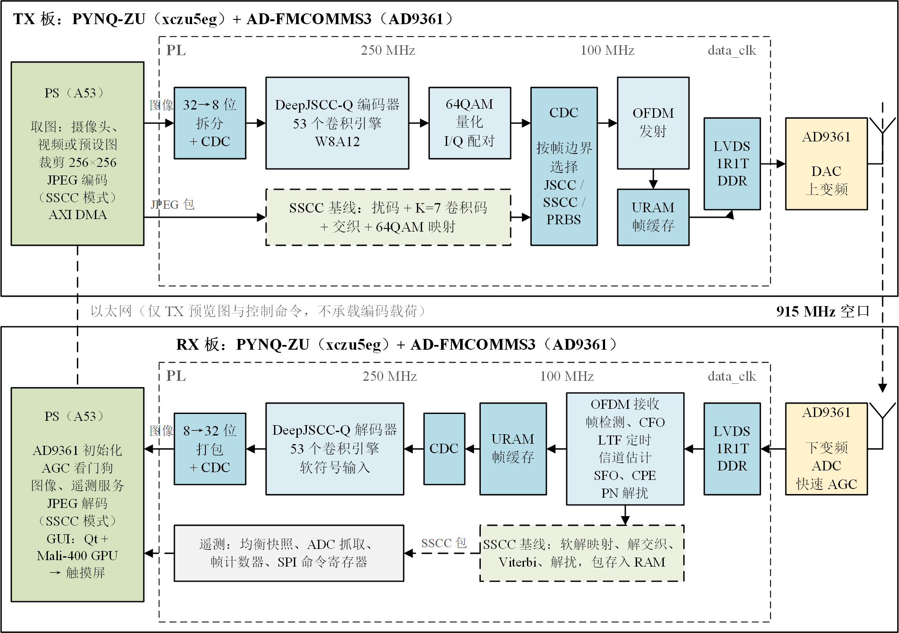

图2-1　系统整体框图。上：TX板，数据从左向右；下：RX板，数据从右向左。虚线框为PL，绿色为PS软件，黄色为射频芯片，虚线边框的模块为SSCC基线。

### 2.1.1 帧与数据量

链路以“一幅图 = 一个PHY帧”组织，各级数据量见表2-1。编码器每33.3 ms产出一帧符号，PHY只用2.748 ms就能把它发完，空口占空比约8 %，其余时间发射机静默。神经网络与PHY的速率差由TX端DAC前和RX端均衡后的两个URAM帧缓存吸收（2.2.3.4节）。

表2-1　一帧的数据量

| 位置 | 内容 | 数量 |
|---|---|---|
| 图像 | 256×256×3，uint8，NHWC顺序 | 196,608字节 |
| 编码器输出 | 64×64×16潜变量，相邻通道配成(I, Q) | 32,768个64QAM符号（24位） |
| OFDM映射 | 每个OFDM符号48个数据子载波；32,768 = 682×48 + 32，末符号补16个零 | 683个OFDM符号 |
| 时域 | 前导320（STF 160 + LTF 160）+ 683×80（含CP 16） | 54,960个采样 = 2.748 ms（20 MSPS） |
| 帧率 | 编码器节奏决定 | 30 fps，帧间隔33.3 ms |

### 2.1.2 时钟域

板上125 MHz晶振经PL中的MMCM产生三个时钟，AD9361另外提供LVDS随路时钟，共四个时钟域（表2-2）。神经网络与PHY之间、PHY与AD9361之间都只经过异步FIFO，每个FIFO同时传送数据和帧边界（`tlast`/`tuser`），帧结构在跨时钟域后保持不变。

表2-2　时钟域

| 时钟 | 频率 | 使用者 |
|---|---|---|
| 网络时钟 | 250 MHz | DeepJSCC-Q编码器 / 解码器 |
| 物理层时钟 | 100 MHz | OFDM物理层、帧缓存、SSCC链路、AXI寄存器与DMA接口 |
| 控制时钟 | 20 MHz | AD9361 SPI、初始化与校准状态机 |
| `data_clk`（AD9361接口时钟） | 40 MHz（AD9361输出） | LVDS收发；1R1T下每个采样占2个时钟周期 |

复位在MMCM锁定、PS的`pl_resetn0`释放后，分别在250 MHz和100 MHz域内用两级寄存器同步释放。XPM异步FIFO只有一个复位输入，所以它的复位要等两个时钟域都完成同步后才释放。AD9361一侧的FIFO读写时钟之一是`data_clk`，而`data_clk`要等AD9361的BBPLL和LVDS配置完成才存在，因此这两个FIFO一直保持复位，直到初始化完成后再过256个控制时钟周期，保证复位期间两侧时钟都已存在。

### 2.1.3 软硬件划分

表2-3　软硬件划分与依据

| 功能 | 位置 | 依据 |
|---|---|---|
| DeepJSCC-Q编码器 / 解码器 | PL，250 MHz | 每帧名义卷积工作量0.913 + 1.417 GMAC，30 fps时约70 GMAC/s，A53无法实时完成 |
| OFDM物理层（IFFT/FFT、同步、信道估计、SFO / CPE跟踪） | PL，100 MHz | 20 MSPS连续采样流，逐采样处理，时延要确定 |
| 帧缓存、跨时钟域 | PL（URAM、XPM FIFO） | 神经网络与PHY的速率不同，实时接口一侧必须整帧缓存 |
| SSCC扰码 / 卷积码 / 交织 / Viterbi | PL | 与PHY一样是逐比特、逐符号的流水处理 |
| AD9361 LVDS接口、TX初始化与正交校准相位扫描 | PL | 接口时序严格；TX板上电即自举，不依赖软件 |
| 取图、中心裁剪、DMA送图 | PS（TX） | 依赖Linux UVC驱动与OpenCV；每帧只有196 KB |
| SSCC的JPEG编 / 解码 | PS | 变长熵编码，控制流复杂，且不是本作品的重点 |
| RX的AD9361初始化、AGC看门狗、TX衰减控制 | PS | 慢速控制；看门狗只读PL计数器，不与基带耦合 |
| 图像转发、遥测、频谱、GUI与三维显示 | PS（RX），三维曲面用Mali-400 GPU | 人机交互 |

### 2.1.4 PS–PL接口

两块板的PS都只用两个AXI端口：PS作为主机，经HPM0_LPD访问PL的寄存器；DMA作为主机，经HP0访问DDR。地址映射见表2-4。图像以整帧为单位传输：TX的MM2S一次送出196,608字节，受编码器反压；RX的S2MM一次收49,152个32位字。

表2-4　PS可见的地址空间

| 板 | 地址 | 模块 | 说明 |
|---|---|---|---|
| TX | 0x8000_0000 | 图像DMA（AXI DMA，MM2S，32位） | 图像或SSCC包 → PL |
| TX | 0x8002_0000 | TX控制寄存器组（AXI4-Lite） | 数据源选择、计数器、AD9361 SPI命令 |
| RX | 0x8000_0000 | 图像DMA（S2MM） | 解码图像 → PS |
| RX | 0x8001_0000 | ADC抓取DMA（S2MM） | ADC原始采样 → PS |
| RX | 0x8002_0000 | RX控制寄存器组（AXI4-Lite） | 软复位、图像转发、抓取、计数器、AD9361初始化与SPI |
| RX | 0x8004_0000 | 遥测接口（AXI4） | 均衡各级快照、SSCC包缓冲 |

寄存器块的主要内容如下（完整定义见源文件头部注释）：

- TX控制寄存器组：
  - 控制寄存器中的两位分别选择数据源（编码器或PRBS 64QAM自测源）和SSCC模式，两者都在帧边界生效；
  - 四个计数器分别计数进入编码器的字节、进入PHY的符号和帧、发往DAC的帧，用于测量分段时延（3.3节）；
  - 帧尾错位计数器计数`tlast`不在第32,767个符号上的帧，用来检查接口约定；
  - SPI命令寄存器与SPI状态寄存器是AD9361的寄存器读写通道：PS写入地址、数据和读/写位，从状态寄存器读回传输计数与读出数据。
- RX控制寄存器组：
  - 软复位位复位PHY与帧缓存；
  - 图像转发控制设置单帧或连续转发解码图像；
  - ADC抓取控制可以立即触发，也可以在下一帧开始时触发；
  - 五个帧计数器依次计数PHY同步、PHY输出、进入帧缓存、整帧丢弃和解码完成的帧；
  - AGC状态寄存器是AD9361 `CTRL_OUT`状态输出引脚的实时值（增益锁定位与增益索引）；
  - 射频控制寄存器（AD9361复位、PS控制模式、初始化完成）与SPI命令、状态寄存器一起，用于PS初始化AD9361。

跨时钟域的控制位和计数器都经两级同步；AD9361的SPI命令用“翻转一次 = 一次传输”的握手跨到20 MHz域，PS写命令后等待传输计数加一再发下一条。

### 2.1.5 神经网络与物理层的接口约定

神经网络与PHY之间的接口约定见表2-5，两侧按同一约定分别实现和验证；PHY可以用格式相同的PRBS 64QAM源代替编码器单独测试。

表2-5　神经网络与PHY的接口约定

| 项 | 约定 |
|---|---|
| 协议 | AXI-Stream，双向valid / ready，任一侧都可以反压 |
| 数据 | `tdata[23:0] = {Q[11:0], I[11:0]}`，Q10补码（1.0 = 1024），每拍一个复符号 |
| 星座 | 64QAM电平158·(2k − 7)，k = 0…7，平均功率1.0 |
| 顺序 | 潜变量按NHWC顺序，通道(2j, 2j+1)配成(I, Q) |
| 帧边界 | 每帧32,768个符号，最后一个符号上`tlast = tuser[0] = 1` |
| RX输出 | 均衡后的连续I/Q（同一格式），不做星座判决 |

## 2.2 硬件系统介绍

### 2.2.1 硬件整体介绍

表2-6　硬件组成

| 部件 | 数量 | 型号 / 规格 | 用途 |
|---|---|---|---|
| FPGA开发板 | 2 | PYNQ-ZU，Zynq UltraScale+ xczu5eg-sfvc784-2-e（4×A53 + Mali-400 MP2，PL 117k LUT / 144 BRAM36 / 64 URAM / 1248 DSP），PYNQ 3.1 | TX、RX各一块 |
| 射频子卡 | 2 | AD-FMCOMMS3-EBZ（AD9361，参考时钟40 MHz） | 915 MHz收发，LVDS 1R1T，FDD |
| 天线 | 2 | 915 MHz天线 | TX板子卡的发射口、RX板子卡的接收口各一根 |
| USB摄像头 | 1 | UVC，MJPG 640×480 @ 30 fps | TX取图（可选，也可用演示视频或预设图） |
| 触摸屏 | 1 | 1024×600，DisplayPort输入，USB触摸 | RX端显示GUI |
| 网线 | 1 | 两块板之间 | 只传TX预览图与控制命令 |

AD9361与PL之间是LVDS数据接口：接收方向有随路时钟`rx_clk_in`、帧信号`rx_frame_in`和6对数据线，发送方向有`tx_clk_out`、`tx_frame_out`和6对数据线；控制方向有4线SPI（`spi_clk/csn/mosi/miso`），以及`resetb`（复位）、`enable` / `txnrx`（收发状态控制）、`en_agc`（AGC使能）、`ctrl_in[3:0]`（增益控制输入）、`ctrl_out[7:0]`（状态输出）等引脚。PL在初始化完成后把`enable`和`txnrx`同时拉高，使AD9361进入FDD收发状态；`en_agc`和`ctrl_in`固定为0。增益由AD9361片内的快速AGC控制，PL只把`ctrl_out`上的增益锁定位和增益索引读给PS。

TX和RX两个工程的PL顶层分别是`jscc_tx_ps_top.sv`和`jscc_rx_ps_top.sv`，模块组成与图2-1一致，AD9361接口、帧缓存和跨时钟域模块两端共用。

### 2.2.2 机械设计介绍

本作品没有机械结构设计。硬件全部采用商用开发板、射频子卡和外设，按表2-6连接即可。

### 2.2.3 电路各模块介绍

PL中的第三方内容只有以下几项，其余RTL（神经网络模块库与生成器、OFDM物理层、帧缓存、SSCC基线链路、AD9361的TX正交校准相位扫描与PS命令通道）均为本作品自行设计：

- AD9361的LVDS数据接口`ad9361_lvds_mode.v`，源自ADI HDL[19]，改为PYNQ-ZU引脚与1R1T模式；
- AD9361的SPI主机`ad9361_spi.v`与初始化序列执行器`ad9361_config.v`，源自lzk2211的Zedboard_AD9361_radar工程[18]，经原作者同意以MIT许可再发布，本作品修正了其握手错误（2.2.3.5节）；
- AD9361的初始化寄存器序列，由ADI配置工具生成；
- Vivado自带IP：FFT、FIR Compiler、CORDIC、DDS Compiler、除法器、Viterbi译码器、XPM FIFO与时钟向导。

#### 2.2.3.1 DeepJSCC-Q编码器与解码器

##### （1）神经网络结构与RTL的生成方式

神经网络结构见图2-2。编码器由9个块组成，把256×256×3图像映射为64×64×16潜变量，共55个卷积算子；解码器由10个块组成，共59个卷积算子，最后经sigmoid输出8位RGB。四种块分别是：RG（带GDN的残差块，可带步长2下采样）、RB（普通残差块）、RU（带PixelShuffle与IGDN的上采样残差块）和ATT（注意力块[5]）。

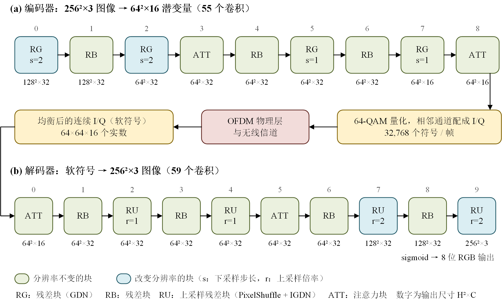

图2-2　部署的神经网络的编码与解码结构。模块序号、步长 / 上采样倍率与各块输出尺寸取自`data/model/manifest.json`。

两端的顶层RTL（`blk_enc_0_latent_idx.sv`、`blk_rx_in_output.sv`）由`src/network/gen_rtl_top.py`根据导出的manifest自动生成，权重、偏置和重定标参数由`gen_rtl_init.py`写成`.mem`初始化文件。生成器从参数化模块库（表2-7）中实例化模块、按神经网络拓扑连线，并按存储规划（本节第7小节）为每个模块填入并行度、ROM组织方式和存储原语。每个模块都与整数参考模型`int_ref.py`逐比特一致。

表2-7　神经网络模块库

| 模块 | 功能 | 关键参数 |
|---|---|---|
| `axis_line_buffer` | K×K卷积的行缓存与窗口读出 | 通道数、宽、高、核尺寸、步长、缓存行数、每个像素的窗口读取遍数、每个RAM字打包的元素数、存储原语 |
| `axis_pixel_buffer` | 1×1卷积的像素缓存（双缓冲） | 通道数、每个像素的读取遍数 |
| `conv_engine` | P路输出通道并行卷积 + 偏置 + 激活 + 重定标 | 输入 / 输出通道数、核尺寸、并行度P、激活函数、权重ROM组织方式、重定标乘法用DSP还是LUT |
| `weight_stream` / `rom_banked` / `rom` | 权重ROM的三种组织方式 | 并行度P、32位ROM列数、每个存储体的深度 |
| `axis_gdn` + `gdn_unit` | GDN / IGDN归一化 | 通道数、乘加通路数、开方与除法单元数、GDN或IGDN |
| `axis_sigmoid` | 32段分段线性sigmoid | 分段数、输出8位还是17位 |
| `axis_gate` | 注意力门y = x + a·σ(b) | 两路的重定标乘数与移位 |
| `axis_add` | 残差相加并重定标 | 两路的重定标乘数与移位、是否加ReLU |
| `axis_pixel_shuffle` | PixelShuffle（深度到空间变换[6]） | 通道数、放大倍数、宽 |
| `centre_tap` | 从3×3窗口流中取出中心像素，供1×1投影旁路使用 | 通道数、核尺寸、主路每像素的读取遍数、转给旁路的遍数 |
| `axis_fifo_packed` | 残差旁路的延迟对齐FIFO，多个元素打包存储 | 每字打包的元素数、深度、存储原语 |
| `axis_fork` / `axis_split` / `axis_tag` | 一路分多路 / 按通道拆分 / 生成帧边界标记 | 分路数、拆分处的通道号 |
| `qam_tx` / `rx_frame` | 神经网络与PHY的边界（本节第8小节） | — |

所有模块之间都是AXI-Stream握手。数据按NHWC顺序一拍传一个元素；`tlast`标记一个像素的最后一个通道，`tuser[0]`标记一帧的最后一拍。整个神经网络是一条带反压的层间流水线：每一层都有自己的计算单元和局部缓存，层间不搬运整幅特征图，下一帧的输入在上一帧尚未输出完时就开始进入。

##### （2）块的RTL组成

四种块在RTL中的组成如图2-3。

- RG：主路依次是行缓存 → 3×3卷积（leaky ReLU，步长1或2）→ 行缓存 → 3×3卷积 → GDN。输入输出通道数或尺寸变化时，旁路是1×1投影卷积，它的输入由`centre_tap`从主路第一个卷积的窗口流中取出每个窗口的中心像素，不另设缓存。主路与旁路在`axis_add`中按y = rsr(a·MA + b·MB, SH)相加，MA、MB是两路的重定标常数。
- RB：两个3×3卷积，旁路是恒等映射，只经过对齐FIFO。
- RU：主路的第一个卷积和旁路的卷积读同一个输入，生成器把它们按输出通道拼成一个引擎（例如`dec.7`的合并引擎有256个输出通道，P = 52），再由`axis_split`拆成两路。两路各经一个`axis_pixel_shuffle`放大2倍；主路继续经3×3卷积和IGDN，旁路进入对齐FIFO，最后相加。
- ATT：特征支路A与门控支路B各由3个瓶颈残差单元组成（1×1 → 3×3 → 1×1）。两支路的第一个1×1卷积读同一输入，同样合并为一个引擎。B支路末端再经1×1卷积和`axis_sigmoid`得到门控值，`axis_gate`计算y = x + a·σ(b)。

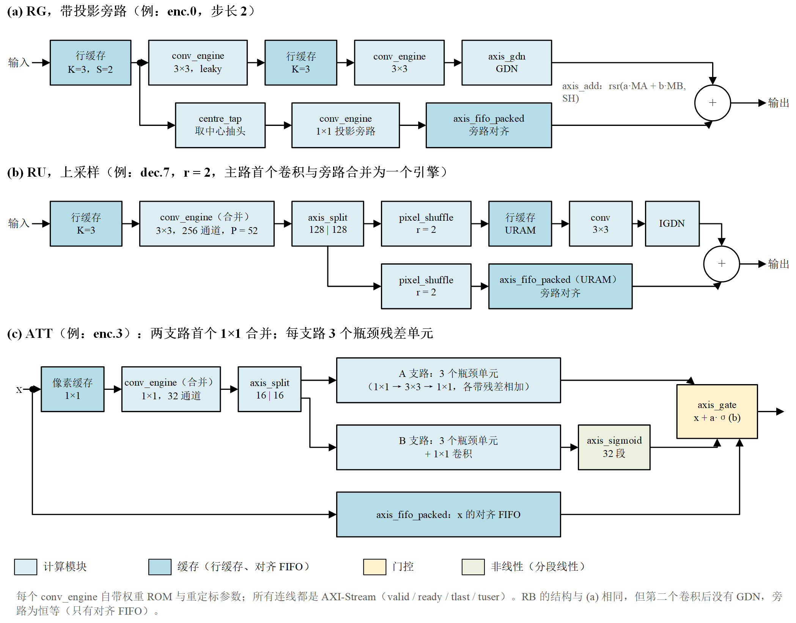

图2-3　RG、RU、ATT块的RTL组成（以enc.0、dec.7、enc.3为例）。

##### （3）行缓存`axis_line_buffer`

每个K×K卷积前有一个行缓存，它保存最近若干行输入，并按卷积引擎需要的顺序读出窗口（S为步长，G为输出通道组数，填充宽度为(K−1)/2）：

```
for (oy, ox)：每个输出像素，光栅顺序，按步长 S 步进
  for g = 0 .. G-1：输出通道分组，G = ⌈Cout/P⌉
    for ky, kx = 0 .. K-1；c = 0 .. C-1
      输出 x[oy·S+ky−(K−1)/2][ox·S+kx−(K−1)/2][c]，越界为 0
```

每个窗口元素读一次就广播给卷积引擎的P条通路，所以激活的读带宽与并行度P无关；每个输出通道组要把整个窗口重读一遍，一个输出像素共读G·K·K·C拍，这就是并行度规划的约束量（本节第7小节）。行缓存的输出边带信号为：`tlast`表示一遍窗口的最后一个元素；`tuser[0]`表示第一个元素；`tuser[1]`表示这一遍属于该像素的最后一组；`tuser[2]`表示该像素是一帧中的最后一个。

这些输入行以环形方式存放在一块RAM中，每6个12位元素打包成一个72位字，正好是BRAM和URAM一个字的宽度。写入采用整字写：打包寄存器累积当前字的元素，每收到一个元素就把整个字写一次，所以一行可以从字的中间开始，不需要读—改—写。流控规则有两条：

- 一个输入元素只有在它要写入的位置不再被当前输出行使用时才被接收，否则反压上游；
- 一个窗口只有在它需要的输入行、列都已写入时才开始读出；读请求按输出FIFO的空位发出，下游可以在任意时刻拉低`tready`。

128×128的层缓存K + 1 = 4行，使写入下一行与读出当前窗口能够重叠；64×64的层取3行。1×1卷积不需要行缓存，用`axis_pixel_buffer`代替：两个像素槽轮换，一个像素重复读出G遍，同时写入下一个像素。

##### （4）卷积引擎`conv_engine`

卷积引擎的结构见图2-4。输入窗口流的每个元素广播给P条乘累加通路；第g遍时，通路p累加输出通道g·P + p，它的权重来自P×8位宽权重字中的第p个字节。一遍窗口结束时，P个累加和被复制到结果寄存器组，再依次送入唯一的一个重定标单元串行处理，累加阵列马上可以开始下一遍，重定标乘法器也只需要一个。

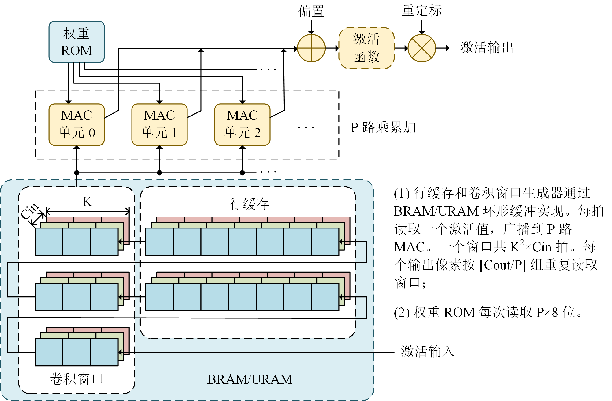

图2-4　输出通道并行卷积引擎：窗口广播、并行累加与串行重定标。

数值处理与整数参考模型逐比特一致：

```math
a=\sum x\,w+b,\qquad
y=\mathrm{sat}_{12}\!\left(\mathrm{rsr}\!\left[\mathrm{sat}_{27}\big(\mathrm{rsr}(a,p)\big)\cdot M_c,\;s_c\right]\right)
```

- 激活为12位补码、权重为8位补码（W8A12），偏置已换算到累加器的尺度；累加器位宽按$`B_{\mathrm{acc}}=B_x+B_w+\lceil\log_2(K^2C_{in})\rceil+1`$生成。
- 激活函数在a上执行：ReLU取max(a, 0)；leaky ReLU在a < 0时取rsr(a, 7)，只需移位。
- $`\mathrm{rsr}(v,k)=(v+2^{k-1})\gg k`$为四舍五入的算术右移。
- 预移位p是层常数；$`M_c`$（17位无符号）与$`s_c`$是逐通道参数，$`s_c`$只存相对于层内最小移位的偏移（2–3位）。先饱和到27位，是为了让乘法正好放进DSP48E2的27×18乘法器。

重定标乘法按该层的结果产生间隔选择实现方式：结果间隔短的层用1个DSP；间隔足够长的层（P路结果依次串行相乘所需的总拍数不超过K·K·C_in）用`mul_serial`，即基4的串行乘法器，每拍处理乘数的2位，只用LUT。

##### （5）权重ROM的三种组织方式

卷积引擎在第g遍读第(ky, kx, c)个元素时需要P个权重同时到达，所以权重ROM的逻辑形状是“宽P×8位、深G·K·K·C_in”。各层的P从1到52不等，生成器按ROM的尺寸在三种方式中选择：

- LUT ROM：小ROM用分布式LUT实现，例如ATT中的1×1卷积和P = 1–3的层。
- BRAM宽字ROM（`rom_banked`）：按每9个通路一列（9×8 = 72位，对应BRAM的512×72配置）切成若干列，深度超过512时再按512分体，读延迟固定。适合P为9的倍数或接近9的倍数的层，例如P = 32、深288的层用4列共8个BRAM18。
- 顺序读ROM + 位宽转换（`weight_stream`）：卷积引擎对权重ROM只做顺序读（地址0到末尾，然后循环），因此权重可以首尾相接地紧凑存放在NCOL列32位ROM中（每列一个512×32的BRAM18），读出端用一个位宽转换器（gearbox）把32·NCOL位的ROM字流转换成每拍P×8位的权重向量，条件是4·NCOL ≥ P。这种方式下ROM的形状与P无关。例如P = 7、深1440的层只用5个BRAM18，而按宽字方式需要3个512×72的存储体（6个BRAM18）。

三种方式结合后，每一层的P都可以取满足帧率预算的最小整数，不受BRAM端口位宽的限制。编码器各层的配置见表2-8。

表2-8　编码器各层的并行度与权重ROM（摘自manifest，同类层合并）

| 层 | C_in→C_out，K，输出尺寸 | P | 组数 | ROM方式 | 重定标乘法 |
|---|---|---:|---:|---|---|
| enc.0.conv1（步长2） | 3→32，3×3，128² | 3 | 11 | LUT | DSP |
| enc.0.conv2、enc.1.conv1/2 | 32→32，3×3，128² | 32 | 1 | BRAM宽字，4列 | DSP |
| enc.2、4、5、6的3×3卷积 | 32→32，3×3，64² | 7 | 5 | 顺序读，5个BRAM18 | LUT |
| enc.3各瓶颈3×3卷积 | 16→16，3×3，64² | 2 | 8 | 顺序读，2个BRAM18 | LUT |
| enc.3、enc.8的1×1卷积 | 32/16→16/32，1×1，64² | 1 | 16–32 | LUT | LUT / DSP |
| enc.7.conv1 | 32→16，3×3，64² | 4 | 4 | BRAM宽字，1列 × 3体 | LUT |

##### （6）GDN / IGDN与其他算子

GDN[4]的计算为$`y_i=x_i/\sqrt{\beta_i+\sum_j\gamma_{ij}x_j^2}`$，IGDN把除法换成乘法。它需要同一像素的全部C个通道到齐后才能计算，又含开方和除法，因此单独做成`axis_gdn`模块（图2-5）：

1. 输入：两个像素槽（LUTRAM）轮换，保存当前像素的x和x²，平方用LUT实现。
2. 乘加：L条DSP通路，第g遍时通路l计算通道g·L + l的分母$`D_i`$：依次读x²[j]（j = 0…C−1），乘以按通路打包存放的 γ，读到j = i时同时锁存x_i。
3. 迭代运算：每遍得到的L个分母连同对应的x_i存入分母寄存器，由派发逻辑轮流交给N个`gdn_unit`（开方与除法单元）。开方用逐位的恢复余数法求$`r=\lfloor\sqrt D\rfloor`$，每拍得到2位；GDN再用恢复余数除法求$`\mathrm{sign}(x)\lfloor|x|2^F/r\rfloor`$，IGDN用移位相加计算x·r。结果按派发顺序回收，输出保持通道顺序。
4. 重定标：与卷积引擎相同的公式，常数乘法用LUT实现。

通路数L和单元数N按该层的像素率配置，例如128×128的`enc.0.gdn`用3条通路、5个迭代单元，64×64的层只用1条通路。

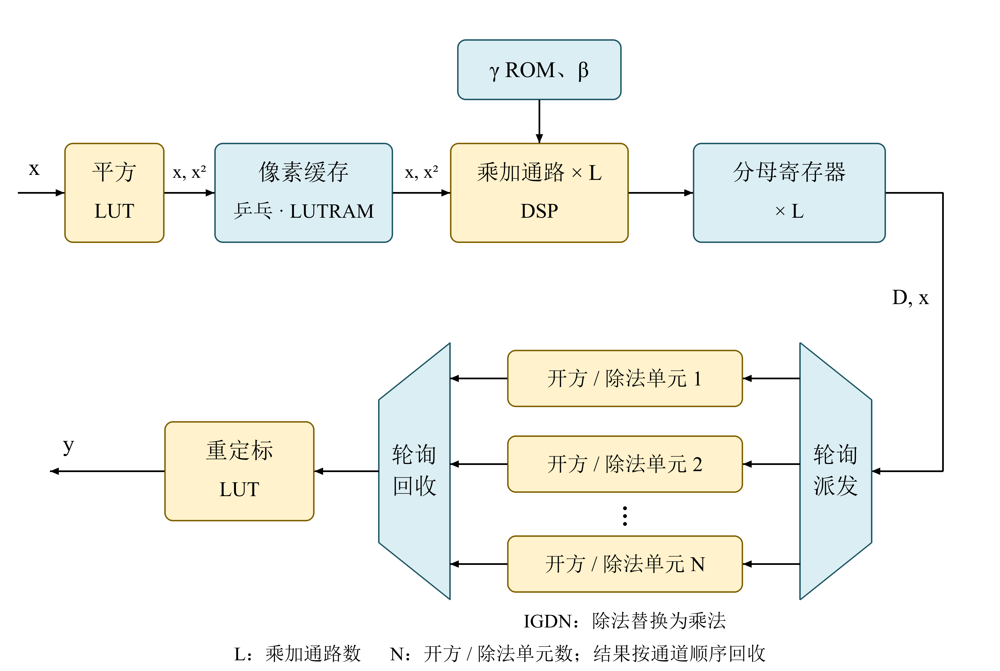

图2-5　GDN / IGDN模块的硬件结构（L为乘加通路数，N为开方 / 除法单元数）。

其他算子：

- sigmoid（`axis_sigmoid`）：32段分段线性近似。取u = |z|，用高位作段号、低位作段内偏移，查两组段系数（存在寄存器中），计算g = c0 + rsr(c1·off, SHIFT)；负半轴利用 σ(−z) = 1 − σ(z)得到。门控值用17位无符号Q0.16表示，以便精确表示1.0。神经网络最后一层的sigmoid直接输出8位像素clamp(rsr(g·255, 16), 0, 255)。乘法用串行LUT乘法器，约12拍出一个元素，与ATT门控支路的元素率匹配。
- 注意力门（`axis_gate`）：y = sat(rsr(x·MA + rsr(a·g, 16)·MB, SH))。
- 残差相加（`axis_add`）：y = sat(rsr(a·MA + b·MB, SH))，可选ReLU；MA、MB、SH都是层常数，用LUT实现常数乘法。
- PixelShuffle（`axis_pixel_shuffle`）：实现out[R·y+i, R·x+j, c] = in[y, x, c·R²+i·R+j]。子行i = 0的R个输出像素直接输出，子行i ≥ 1写入行缓冲，一行输入处理完后顺序读出，恰好就是输出行R·y+1 … R·y+R−1的光栅顺序。
- 中心抽头（`centre_tap`）：只保留3×3窗口流中位于窗口中心（ky = kx = 1）的C_in个元素，并按1×1卷积的格式重写边带信号。

##### （7）并行度与片上存储规划

`src/network/memory_plan.py`在生成RTL之前为每个引擎确定并行度和存储映射。并行度取满足帧率预算的最小整数：

```math
P_l=\min\Big\{p:\;H_oW_o\,K^2C_{in}\Big\lceil\frac{C_{out}}{p}\Big\rceil\le 0.8\,\frac{f_{\mathrm{clk}}}{F_{\mathrm{target}}}\Big\}
,\qquad f_{\mathrm{clk}}=250\ \mathrm{MHz},\;F_{\mathrm{target}}=30\ \mathrm{fps}
```

不等式左边是该层每帧要读的窗口元素数，右边是每帧的时钟周期数，留20 %余量给流水启动和反压。按此规划，编码器、解码器的乘累加通路分别为217和296条（图2-6(a)）。分支合并把114个卷积算子映射为106个引擎（编码、解码各53个），合并卷积入口不改变名义乘加工作量，只减少重复的窗口读取和引擎数量（合并方式见图2-3）。

片上存储按“每个神经网络核BRAM36不超过100块”的预算分配：xczu5eg共144块BRAM36，RX端除解码器外，物理层、SSCC基线和PS接口还要占用约24块。权重ROM必须在配置时带初值，而URAM不能初始化，所以权重留在LUT和BRAM中；激活缓存（行缓存、对齐FIFO、PixelShuffle行缓冲）则按“每块URAM能替代的BRAM数”从大到小放进URAM，直到BRAM用量回到预算以内。最终编码器规划用97.5块BRAM36和4块URAM，解码器用99.5块BRAM36和18块URAM（图2-6(c)）。

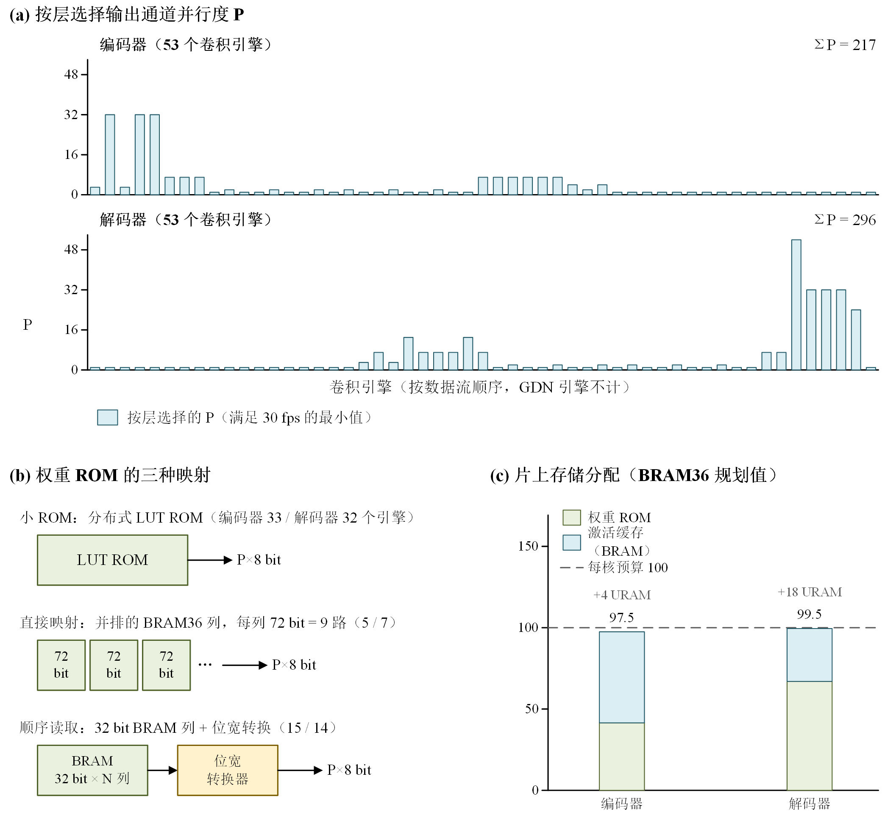

图2-6　(a)按层选择的并行度P；(b)权重ROM的三种组织方式及各自的引擎数；(c)片上存储分配（BRAM36规划值）。

把上述几处设计逐一换成不做该项优化时的常规做法，用同一个存储规划程序计算资源，结果见表2-9（规划值，最终实现的资源见3.2.2节）。按层取最小并行度决定了DSP用量；三种ROM组织方式与URAM放置规则一起，使两端BRAM36都不超过100块，同时URAM用量最少。

表2-9　本设计与常规做法的资源对比（规划值，编码器 / 解码器）

| 设计项 | 常规做法 | 常规做法的资源 | 本设计 |
|---|---|---|---|
| 并行度 | 各层统一取最大P（32 / 52） | 通路1120 / 1191条，为本设计的5.2 / 4.0倍 | 每层取满足帧率的最小P，乘累加通路217 / 296条 |
| 权重ROM | 全部用BRAM宽字ROM | ROM共67.5 / 92块BRAM36；为保持每端100块BRAM36，需把更多激活缓冲移入URAM，URAM 14 / 40块 | 含GDN的γ ROM：LUT ROM 37 / 36个、BRAM宽字5 / 7个、顺序读加位宽转换15 / 14个，ROM共41.5 / 67块BRAM36 |
| 权重ROM | 不用位宽转换（其余不变） | ROM共49 / 74块BRAM36，URAM 6 / 22块；省去约5.8k / 5.3k LUT | 同上 |
| 激活缓冲 | 全部放在BRAM | BRAM36共114 / 149块，解码器超过xczu5eg的144块 | 按每块URAM能替代的BRAM数从大到小移入URAM，BRAM36共97.5 / 99.5块，URAM 4 / 18块 |
| 重定标乘法 | 全部用DSP | DSP多43 / 43个 | 43 / 43个引擎用串行LUT乘法器（约3.0k LUT），其余10 / 10个用DSP |

##### （8）神经网络与物理层的边界

- 编码器出口`qam_tx`：编码器最后一层输出12位整数潜变量。`qam_tx`用7个门限（−343、−229、−115、0、114、228、342，即相邻星座电平的中点换算到整数尺度）把每个元素量化为8个电平之一，再映射为Q10电平 ±158、±474、±790、±1106。每两个相邻元素配成一个 {Q, I} 符号。模块只有一个暂存I的寄存器和一个输出寄存器，突发缓冲由PHY负责。
- 解码器入口`rx_frame`：把每个 {Q, I} 符号按I、Q两拍拆回两个通道，并根据张量尺寸重新生成像素级的`tlast`和帧级的`tuser`。入口不做星座判决，均衡后的噪声和残差原样进入解码器，这正是DeepJSCC在低SNR下平缓退化的前提。

#### 2.2.3.2 OFDM发射链

物理层以802.11a[7]为参考自行设计，主要区别是：调制方式固定为64QAM、帧长固定为683个OFDM符号，因此去掉了SIGNAL字段；DeepJSCC-Q模式下神经网络直接输出星座点，比特级处理（扰码、卷积码、交织、QAM映射）只在SSCC基线中使用（2.2.3.6节）。发射链全部工作在100 MHz，结构见图2-7，帧格式与子载波分配见图2-8。

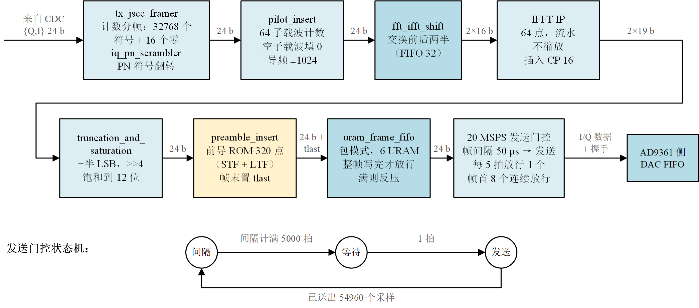

图2-7　OFDM发射链（`tx_baseband_jscc.sv`）与20 MSPS发送控制。所有模块之间都是带反压的AXI-Stream，整条链路只在DAC前有一个帧缓存。

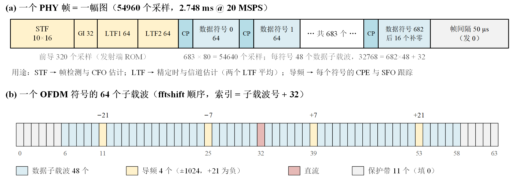

图2-8　PHY帧格式（上）与一个OFDM符号的子载波分配（下，fftshift顺序，索引 = 子载波号 + 32）。

各模块依次为：

1. 分帧与PN符号翻转（`tx_jscc_framer`、`iq_pn_scrambler`）：按计数分帧，每帧先放行32,768个输入符号，再插入16个零符号，凑满683×48个数据子载波；输入的`tlast`只用来检查接口约定。DeepJSCC的输出沿NHWC顺序是相关的：相邻符号的相关系数为0.17–0.27，相隔16个符号（同一像素位置的同一通道）为0.28–0.42，直接映射到子载波会使OFDM的PAPR比随机64QAM高1–2 dB。因此用802.11扰码多项式$`x^7+x^4+1`$（初值1011101）生成的伪随机序列对I、Q分别做符号翻转：每个符号LFSR走两步，第一位决定I是否取反，第二位决定Q；LFSR每帧复位。符号翻转不改变星座集合，对神经网络完全透明，RX用同一模块再翻转一次即可恢复。
2. 插导频（`pilot_insert`）：对每个OFDM符号的64个子载波计数。索引0–5、32（直流）、59–63填0；索引11、25、39、53（子载波 −21、−7、+7、+21）填导频 ±1024，其中 +21为 −1024；其余48个位置依次取数据。插入空子载波和导频时拉低对上游的`tready`。
3. 顺序变换与IFFT：`fft_ifft_shift`用32深的FIFO交换前后两半，把居中排列的子载波换成IFFT的自然顺序，再送入FFT IP。IP配置为64点、流水线结构、不缩放，并由IP插入16点循环前缀。
4. 数字功率回退（`truncation_and_saturation`）：OFDM是多个子载波的叠加，时域峰值远高于平均值，加PN翻转后PAPR的99 %分位仍约为9.6 dB。DAC只有12位，峰值一旦超出满量程就会被削顶，产生带内失真和带外辐射，因此IFFT的19位输出要按“峰值不削顶”来定标。设计取右移4位（加半个最低位舍入，再饱和到12位）：数据的每轴RMS约为322，比满量程2047低约16 dB，大于PAPR的尾部，实测三张测试图的最大峰值为1765。右移是2的幂次，不需要乘法器；回退损失的发射功率由AD9361的TX衰减补偿。
5. 插前导（`preamble_insert`）：320个前导采样（STF 160 + LTF 160）存在BRAM ROM中，与数据按相同定标输出，帧的最后一个采样上置`tlast`。
6. 帧缓存（`uram_frame_fifo`，包模式）：见2.2.3.4节。
7. 20 MSPS发送控制：顶层的三状态机：帧间隔 → 等待整帧 → 发送。发送状态每5个100 MHz时钟放行1个采样（20 MSPS），共54,960个；帧开头的8个采样连续放行，预先填充AD9361一侧的FIFO。帧间隔状态在两帧之间插入至少50 µs（1000个采样）的空闲：RX的帧检测器确认一帧后要输出一帧长度加100个余量的采样，再回到搜索状态，并在下一帧的STF中重新累计64个满足条件的采样；若两帧背靠背发送（如PRBS自测满速发送时），下一帧的STF就会落在上一帧的输出窗口内而被漏检。正常运行时帧间隔由编码器决定（33.3 ms），帧间隔状态只起保底作用。

#### 2.2.3.3 OFDM接收链

接收链结构见图2-9。ADC采样流不能反压，所以接收链各级的平均吞吐都高于20 MSPS，并在帧检测、定时同步和CPE处各有一个小FIFO吸收短时的流水停顿。

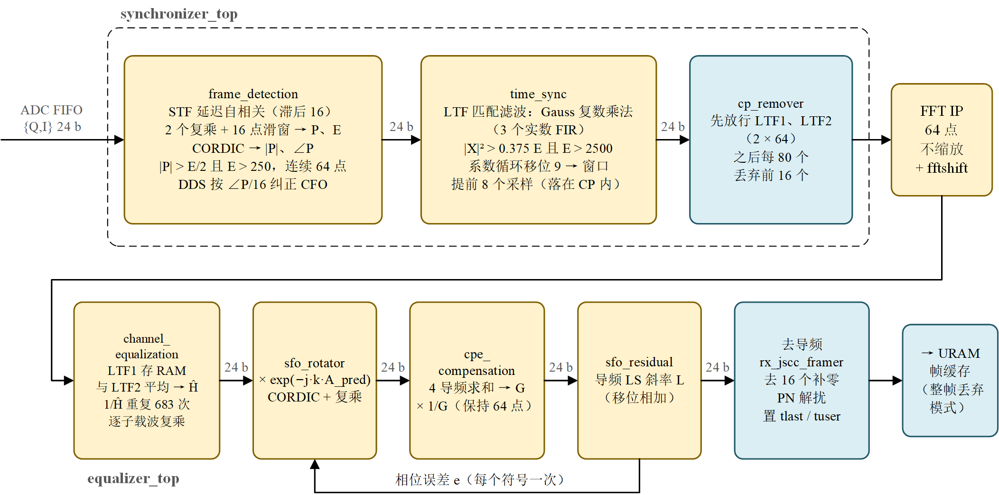

图2-9　OFDM接收链（`rx_baseband_top.sv`）。

##### （1）帧检测与载波频偏纠正`frame_detection`

帧检测利用STF以16个采样为周期重复的特性，采用延迟自相关方法[8]（图2-10）。输入同时进入16点延迟线和128深FIFO；两个复数乘法器分别计算$`r_n r_{n-16}^*`$和$`|r_{n-16}|^2`$，再各做16点滑动求和，得到自相关$`P_n`$和能量$`E_n`$；CORDIC IP把$`P_n`$转成幅度和相位。判决条件为：

- $`|P_n|>E_n/2`$，即归一化自相关大于0.5，E/2只需右移一位；
- $`E_n>250`$（对应RMS约126），无信号时噪声不会触发。

两个条件需连续满足64个采样才确认检测。图2-11的仿真条件为两板晶振标称偏差的最坏情况（各 ±20 ppm，相对频偏40 ppm，即915 MHz下36.6 kHz）、半个采样的定时偏移和10 dB SNR：噪声段和数据段的归一化自相关也会偶尔超过0.5，但都持续不到64个采样；STF内则连续满足，在帧起点后约100个采样处确认。

确认时$`P_n`$的相位就是16个采样内的载波相位差，右移4位即每个采样的相位增量，送入DDS IP产生纠正因子，与FIFO中缓存的采样相乘完成频偏纠正。滞后16的自相关可估计的频偏范围为 ±fs/32 = ±625 kHz，远大于36.6 kHz；估计的残余误差由后面的CPE跟踪逐符号补偿。复数乘法的结果先取14位、再饱和到12位，防止满量程附近的样点溢出反号。

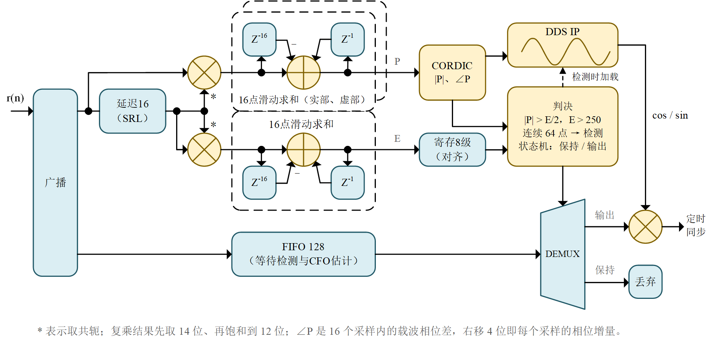

图2-10　帧检测与载波频偏纠正的硬件结构（`frame_detection.sv`）。

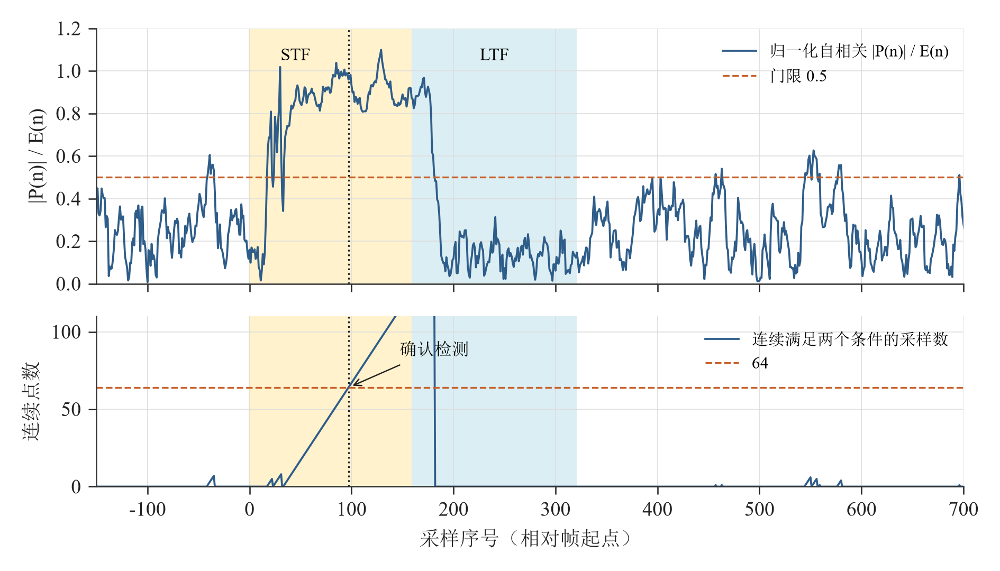

图2-11　帧检测算法仿真：上为归一化自相关与门限，下为连续满足两个条件的采样数（40 ppm频偏、半个采样定时偏移、10 dB SNR）。

##### （2）LTF精定时`time_sync`

精定时用已知的LTF序列做匹配滤波（图2-12）。复数匹配滤波用Gauss复数乘法算法以3个实数FIR实现：$`k_1=\mathrm{FIR}_c(I)`$，$`k_2=\mathrm{FIR}_d(Q)`$，$`k_3=\mathrm{FIR}_{c+d}(I+Q)`$，则实部为$`k_1-k_2`$，虚部为$`k_3-k_1-k_2`$，比直接实现少用1/4的乘法器。三个FIR共用一个FIR Compiler IP配置（3组系数）。互相关的模平方与64点滑动能量比较，判决条件为：

```math
|X_n|^2>0.375\,E_n,\qquad E_n>2500
```

其中0.375 = 1/4 + 1/8，只需移位相加。门限按最坏情况确定：两块板的采样相位互不相关，最坏时LTF位于两个采样的正中间，相关峰被分到相邻两个采样上而降低。图2-13的仿真中，整数采样对齐时LTF1的归一化相关峰 ρ²为0.91，偏移半个采样时相关峰分到相邻两个采样上，只有0.54和0.44（见图中局部放大）；数据段的 ρ²不超过0.11。RTL的门限0.375对应 ρ² ≈ 0.46，在最坏情况下仍能检测到LTF1，并与数据段保持足够距离。

匹配滤波器的系数整体循环移位了9个抽头，使检测提前9个采样触发，LTF1、LTF2和所有数据符号的FFT窗口都落在CP内8个采样处。这一固定偏移只在各子载波上引入固定相位，会被信道估计吸收；同时给采样频偏引起的定时漂移留出8个采样的余量（见本节第4小节）。

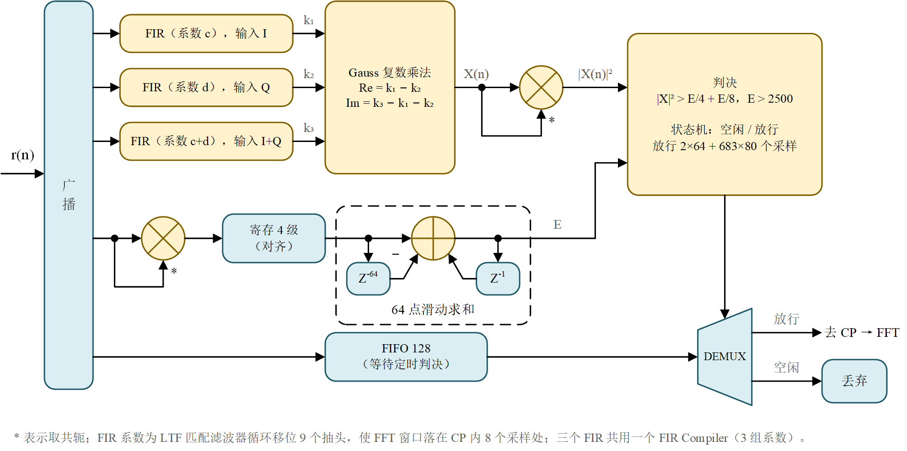

图2-12　LTF精定时的硬件结构（`time_sync.sv`）。

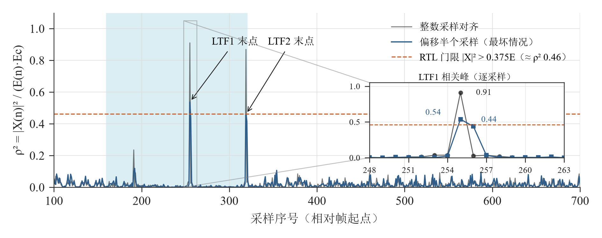

图2-13　LTF匹配滤波的归一化相关（10 dB SNR、40 ppm频偏）：整数采样对齐与偏移半个采样的对比。

##### （3）去CP、FFT与信道估计

`cp_remover`先放行LTF1、LTF2的两个64点窗口，此后每80个采样丢弃前16个。FFT IP为64点、不缩放、自然顺序输出，经`fft_ifft_shift`换回居中顺序。`channel_equalization`做最小二乘信道估计：

1. LTF1乘以已知的 ±1后存入64×24的分布式RAM；
2. LTF2到达时与同一子载波的LTF1求平均，得到$`\hat H_k`$，两次平均使估计噪声降低3 dB；
3. `reciprocal_cplx`计算$`1/\hat H_k=\hat H_k^*/|\hat H_k|^2`$，两个除法器IP并行求实部、虚部；
4. 64个倒数在整帧683个数据符号上重复使用，与每个数据符号逐子载波相乘（迫零均衡）。

帧内的时变由后面的CPE和SFO跟踪补偿。

##### （4）SFO跟踪与CPE补偿

每块AD-FMCOMMS3的参考晶振标称精度为 ±20 ppm，两块板之间最坏的相对偏差为40 ppm。AD9361的采样时钟与本振来自同一参考，因此采样频偏（SFO）也按40 ppm设计。一帧有54,960个采样，40 ppm的SFO到帧尾累积2.2个采样的定时漂移，在边缘子载波（k = ±26）上对应2π·26·2.2/64 ≈ 5.6 rad的相位旋转，远超64QAM的判决容限（最外角点约7.7°）。DeepJSCC不做判决，但这一旋转会直接成为解码器输入的误差，所以必须逐个OFDM符号跟踪。前述8个采样的FFT窗口提前量大于2.2个采样，保证整帧内窗口不移出CP。

跟踪方法参考文献[9]，跟踪环由三个模块组成（图2-14）：

- `sfo_rotator`（在CPE之前）：对第n个数据符号的第k个子载波（k = −32…31）乘以$`e^{-jkA_{\mathrm{pred}}}`$，$`A_{\mathrm{pred}}=A+R`$是本符号预测的相位斜率（rad/子载波）。相位由累加器逐子载波递减$`A_{\mathrm{pred}}`$生成，经CORDIC得到cos/sin。相位以 π 为单位定点表示（$`2^{29}`$对应 π），截取高位送CORDIC，相位超过 ±π 时自然回绕，所以累积漂移可以超过一个采样。
- `cpe_compensation`：4个导频按已知极性求和，得到公共增益G的估计；`reciprocal_cplx`求1/G后与该符号的64个子载波相乘（数据在64点FIFO中等待1/G），同时补偿公共相位和缓慢的幅度变化。输出直接是Q10，即解码器的输入尺度。
- `sfo_residual`（在CPE之后）：数据直通，只在导频经过时累加残余相位斜率的最小二乘估计

  ```math
  L=-21\,\mathrm{Im}\,p_{11}-7\,\mathrm{Im}\,p_{25}+7\,\mathrm{Im}\,p_{39}-21\,\mathrm{Im}\,p_{53}
  ```

  导频极性已并入符号，21 = 16 + 4 + 1，7 = 8 − 1，只需移位相加。这里用导频的虚部代替相角，前提是：CPE已去掉公共相位并把导频幅度归一到1024，跟踪环又已补偿了预测斜率，剩下的残余相角 θ 很小，于是$`\mathrm{Im}\,p=1024\sin\theta\approx1024\,\theta`$，不需要再用CORDIC求相角。

收到残差e后，`sfo_rotator`按二阶环更新：

```math
R\leftarrow R+e/256,\qquad A\leftarrow A_{\mathrm{pred}}+e/8
```

R是每个符号的斜率增量，对应SFO本身。旋转放在CPE之前，是因为斜率大时4个导频的相位彼此不同，直接求和会使CPE估计变小甚至反号（漂移0.71个采样时下降6 dB，1.15个采样时反号）。`sfo_rotator`等上一个符号的残差返回后才开始下一个符号，所以第n个符号的残差从第n+1个符号起生效。A和R在每帧第一个数据符号处清零，以LTF时刻的信道估计作为本帧的定时参考。e换算到相位单位需要乘170.29，用128 + 32 + 8 + 2 = 170近似（误差 −0.17 %），也只需移位相加。整个跟踪环只用一个CORDIC和一个复数乘法器。

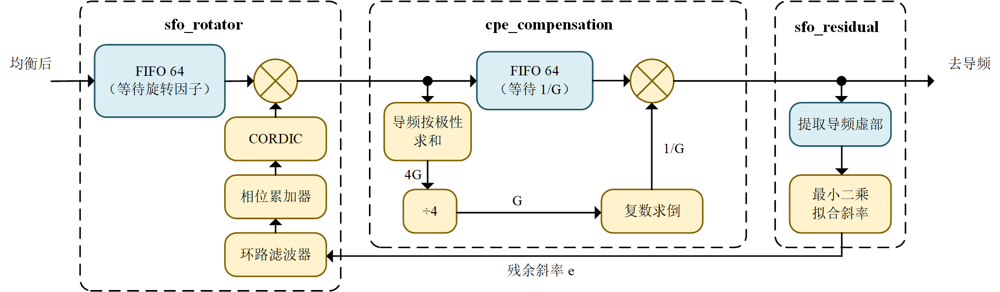

图2-14　SFO旋转、CPE补偿与残余斜率测量构成的二阶跟踪环。

跟踪环的性能用逐符号仿真评估（图2-15）：仿真按上述RTL的运算进行（导频求CPE、残余斜率最小二乘估计、二阶环更新、残差下一符号生效、每帧开头清零），不加噪声。CPE补偿是逐符号的前馈：每个符号用自己的4个导频估计并除掉公共相位，60°的CPE阶跃在当前符号即被完全消除，且对称导频使CPE与斜率估计互不影响，斜率环输出保持为0。斜率阶跃（定时偏移0.25～1个采样）下，二阶环的超调约14 %，5 %调节时间约65个符号，三种幅度的响应几乎重合，说明用导频虚部近似相角在此范围内基本保持线性；线性化后闭环极点约为0.92和0.95，接近临界阻尼。40 ppm的SFO斜坡输入下，不跟踪时帧尾k = 26子载波的相位旋转约320°；跟踪后该子载波的相位误差在第14个符号达到最大2.8°，第100个符号后不超过0.1°，帧尾为0，即二阶环对斜坡输入无稳态误差。起始瞬态的2.8°也小于64QAM最外角点约7.7°的判决容限。

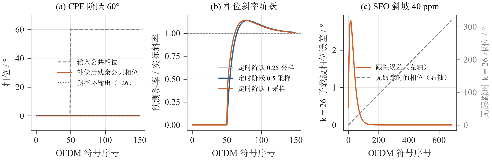

图2-15　跟踪环的响应（仿真，无噪声）：(a) CPE阶跃60°；(b) 相位斜率阶跃，纵轴为预测斜率与实际斜率之比；(c) 40 ppm SFO斜坡下k = 26子载波的相位误差（左轴）与不跟踪时的相位（右轴）。

##### （5）去导频、去补零与PN解扰

`equalizer_top`的输出在空子载波和导频位置拉低valid，只留下48个数据子载波。`rx_jscc_framer`按计数丢弃每帧最后16个补零符号，用与TX相同的`iq_pn_scrambler`再翻转一次符号，并在第32,767个符号上置`tlast`与`tuser`。

#### 2.2.3.4 帧缓存与跨时钟域

`uram_frame_fifo`用6块URAM288（共24,576个72位字）存放采样，每个字打包3个24位采样，有两种工作模式：

- 包模式（TX，DAC前）：输入满时反压上游；一帧完整写入后才允许读出，所以20 MSPS的读出在帧内不会断流。一帧54,960个采样等于18,320个字，容量约1.34帧。缓存放在这里，是因为编码器只能以约每秒100万个符号的平均速率产出，而DAC必须以20 MSPS连续取走2.75 ms，必须先攒满一帧。
- 整帧丢弃模式（RX，均衡后、解码前）：输入不反压；每帧第一个符号到达时判断剩余空间能否放下整帧，放不下就整帧丢弃，并记入整帧丢弃计数器，输出直通，容量2.25帧（32,768个符号等于10,923个字）。缓存放在均衡之后，是因为这里每帧只有32,768个有效符号；若放在ADC一侧，同样的作用需要存约66万个采样。

解码器每帧约需30 ms，小于帧间隔33.3 ms，所以RX帧缓存不会写满。跨时钟域统一使用`axis_async_fifo`（基于Xilinx XPM `xpm_fifo_axis`，独立时钟、两级同步、首字直通，深度32，LUTRAM实现），`tlast`与`tuser`作为数据的一部分一起跨域。

#### 2.2.3.5 AD9361接口与射频控制

##### （1）LVDS数据接口`ad9361_lvds_mode`

接收方向，`rx_clk_in`经IBUFGDS和BUFG成为`data_clk`，6对数据线和帧线经IBUFDS、IDDRE1转成单沿数据，帧信号的4位样式为1100时把两拍各6位拼成12位的I和Q；发送方向由ODDRE1产生随路时钟和数据。1R1T下每个采样占2个`data_clk`周期，20 MSPS对应`data_clk` 40 MHz。`data_clk`域与100 MHz域之间各有一个异步FIFO：

- DAC侧FIFO为空时输出0。AD9361的收发状态机（ENSM）始终保持在FDD状态，帧间的“静默”靠发送0实现，而不是在发送、接收、待机状态之间切换。原因是ENSM的状态切换需要时间，`enable`、`txnrx`引脚的阶跃也会耦合到射频输出上。
- ADC侧FIFO满时丢样。RX物理层各级的吞吐都高于20 MSPS，对ADC侧始终保持ready，所以这个FIFO不会写满。

##### （2）SPI主机与总线归属

`ad9361_spi`是20 MHz的24位SPI主机。lzk2211原工程中，SPI主机只要读或写请求为高就连续发起传输，而初始化模块在等待应答期间一直保持请求，于是每次传输结束后都会立刻重发上一条命令，应答与读回数据整体错后一个事务。所有“轮询某寄存器直到校准完成”的步骤读到的都是上一条命令的结果，轮询提前通过，TX正交校准等步骤在未完成时就进入了后续配置，TX的I/Q失衡得不到校正。本作品把SPI主机改为“每个请求脉冲只发起一次传输”。

SPI总线在不同阶段属于不同的主控，由一个三选一的多路选择器切换（图2-16(a)）：

1. 上电后属于初始化序列执行器`ad9361_config`，按ADI配置工具生成的寄存器序列配置BBPLL、LO、FIR、校准等；
2. 初始化完成后，TX板交给`ad9361_txq_search`执行TX正交校准相位扫描；
3. 扫描完成（射频就绪，同时点亮LED）后，交给PS寄存器驱动的命令通道，供PS读写任意寄存器（如TX衰减、AGC状态）。

RX板的初始化序列由PS执行（2.3.2.3节），SPI从一开始就交给PS命令通道。

##### （3）TX正交校准相位扫描`ad9361_txq_search`

AD9361的TX正交校准借助RX回环测量TX的I/Q失衡，校准能否收敛取决于RX NCO的相位设置，而收敛的相位范围随LO频率和FIR群时延变化，不能使用固定值。ADI的no-OS驱动[11]为此在软件中扫描32个相位、取收敛范围的中点（`ad9361_tx_quad_phase_search()`）。本作品把这一过程做成PL状态机（流程见图2-16(b)），上电自动执行，TX板不依赖软件即可完成射频初始化：

1. ENSM进入ALERT状态，关闭RX正交跟踪；
2. 对相位p = 0…31依次设置NCO相位、启动TX正交校准、轮询完成标志，读校准状态判断是否收敛，结果存入32位收敛图；
3. 在收敛图中找最长的循环连续段，取其中点（没有任何相位收敛时取默认值4）；
4. 在选定相位上做最后一次校准，恢复RX正交跟踪和ENSM状态。

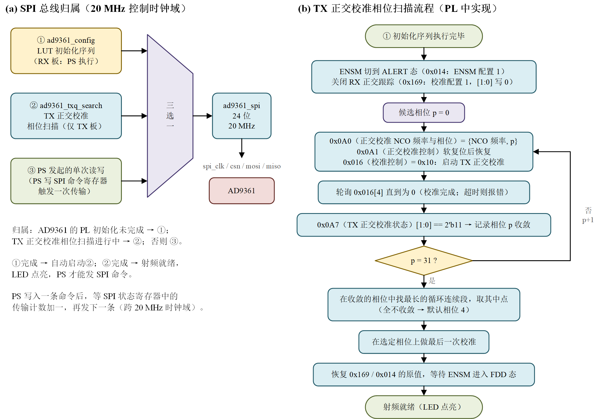

图2-16　AD9361控制：(a) SPI总线的三段归属；(b) TX正交校准相位扫描流程。

##### （4）可编程FIR

AD9361的TX插值滤波链与RX抽取滤波链末端各有一个可编程FIR。本作品重新设计了这两个FIR（Kaiser窗，TX 64抽头、RX 48抽头），目标是在52个子载波占用的 ±8.1 MHz带宽内保持平坦，同时把滤波器冲激响应的能量集中在CP（16个采样）以内，避免符号间干扰。

#### 2.2.3.6 SSCC基线链路

SSCC基线在同一物理层、同一星座电平与TX衰减、每幅图同样32,768个符号的条件下与DeepJSCC-Q对比，信道编码全部在PL中实现（表2-10）。

表2-10　SSCC基线的PL实现

| 方向 | 模块 | 实现 |
|---|---|---|
| TX | `sscc_tx_bits` | PS送来的12,272字节包，高位先出，用802.11扰码器（每帧复位）扰码，再补128个零尾比特使网格回到零状态 |
| TX | `conv_enc_k7` | 卷积码，约束长度7，生成多项式(171, 133)₈，码率1/2 |
| TX | `sscc_interleaver` | 802.11a两步置换交织，N = 384（64个64QAM符号）、s = 3 |
| TX | `qam64_map` | 格雷映射，电平与DeepJSCC相同（158·(2k−7)） |
| RX | `sscc_sync_fifo` | 1024深，PHY的输出不能被反压 |
| RX | `qam64_softdemap` | 简化的max-log软解映射，5位软比特 |
| RX | `sscc_deinterleaver` | 交织的逆置换 |
| RX | `sscc_vit_feed` + Viterbi IP | 每帧送入98,304对软比特后补512对零，使译码器立即输出帧尾比特；回溯深度48 |
| RX | `sscc_rx_bits` | 解扰、拼字节，写入双缓冲包RAM，PS经遥测接口读取 |

一帧的信息比特为32,768 × 6 / 2 = 98,304，减去128位零尾后正好是12,272字节，即SSCC包的长度；包内是12字节包头（魔数、帧号、JPEG长度、质量因子、CRC32）加JPEG数据。TX端由`frame_src_mux`在帧边界切换JSCC与SSCC两路符号；RX端对每个PHY帧同时做两种处理，解码器照常解码，`sscc_rx`同时把它当作SSCC帧译码，PS根据TX当前的模式选用其中一种结果。

## 2.3 软件系统介绍

### 2.3.1 软件整体介绍

软件分为两部分：

- 板上软件：运行在两块板的PS上（PYNQ 3.1，Ubuntu 22.04，Python 3），负责取图、送图、收图、射频控制和显示，结构见图2-17；
- PC端工具链：负责模型训练、整数量化与导出、神经网络RTL生成、比特流构建和测量数据分析，结构见图2-22。

板上程序全部由systemd服务管理，上电约1分钟后链路自动建立，触摸屏显示GUI，演示时不需要PC。

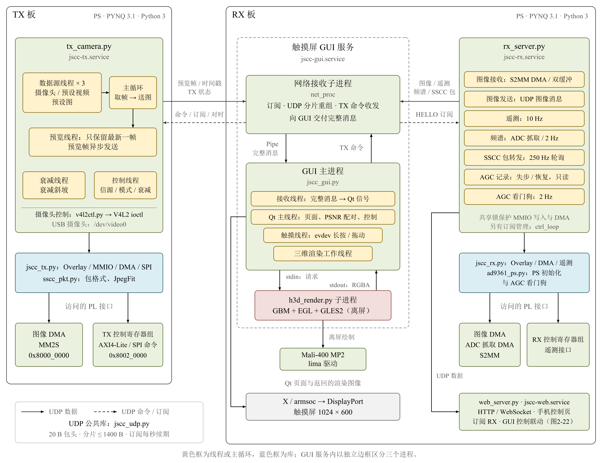

图2-17　板上软件架构：两块板PS上的进程与线程、它们访问的PL接口，以及板间、板内的UDP连接。

表2-11　板上软件

| 板 | 服务 / 进程 | 文件 | 功能 |
|---|---|---|---|
| TX | `jscc-tx.service` | `tx_camera.py` | 取图（摄像头 / 演示视频 / 预设图）、送图、模式与衰减控制、预览转发 |
| TX | （库） | `jscc_tx.py`、`sscc_pkt.py`、`v4l2ctl.py` | PL驱动（Overlay、寄存器、DMA、AD9361 SPI）、SSCC包格式与JPEG质量自适应、UVC控制 |
| RX | `jscc-rx.service` | `rx_server.py` | 收图、遥测、频谱、SSCC包、AGC看门狗，经UDP转发给GUI |
| RX | （库） | `jscc_rx.py`、`ad9361_ps.py` | PL驱动、AD9361的PS初始化与AGC看门狗 |
| RX | `jscc-gui.service` | `jscc_gui.py` | 触摸屏GUI（PyQt5 + pyqtgraph） |
| RX | GUI的子进程 | `h3d_render.py` | 在Mali-400 GPU上离屏渲染信道 \|H\| 三维曲面 |
| 两板 | （库） | `jscc_udp.py` | UDP协议：20字节包头，消息分片与重组 |

板上进程之间、板与板之间都走UDP。消息被切成不超过1400字节的分片，避免IP分片；订阅方每秒向数据源发一次订阅消息，数据源向最近5秒内发过订阅消息的地址推送数据，所以板上不需要预先配置对方的地址。

### 2.3.2 软件各模块介绍

#### 2.3.2.1 TX主程序`tx_camera.py`

TX主程序的流程见图2-18，它由一个主循环和若干后台线程组成：

- 主循环：取一帧新图像 → 必要时切换模式 → 送入PL → 转发预览。
- 数据源线程：三个线程分别维护摄像头、演示视频（30 fps循环播放）和预设图（按30 fps重复）的最新一帧，并带序号；主循环只取序号比上次新的一帧，同一帧不会重复送入编码器。摄像头图像经MJPG解码、中心裁剪480×480、用OpenCV的区域插值（`INTER_AREA`）缩小到256×256、BGR转RGB，得到的uint8 (H, W, C)数组正好是编码器要求的NHWC顺序；饱和度、对比度、gamma用`v4l2ctl.py`直接调用V4L2 ioctl设置。
- 控制线程：接收GUI发来的切换信源、切换模式、设置TX衰减命令和对时请求，每条命令都回复当前状态。
- 预览线程：把交给编码器的那一帧原图发给GUI，用于计算PSNR；只保留最新一帧并在单独的线程中发送，主循环不等网络。

表2-12　TX主程序的关键输入输出

| 函数 | 输入 | 输出 |
|---|---|---|
| `JsccTx.send_image(img)` | (256, 256, 3) uint8 | MM2S DMA送入196,608字节；DMA受编码器反压，返回时编码器已收下整幅图 |
| `JsccTx.send_packet(pkt)` | 12,272字节SSCC包 | 同一DMA送入SSCC发射链 |
| `JsccTx.set_mode(m)` / `set_source(s)` | 工作模式（DeepJSCC-Q / SSCC）；数据源（编码器 / PRBS自测） | 写控制寄存器中的模式位或数据源位，PL在帧边界切换 |
| `JsccTx.set_tx_atten(db)` | 0–89.75 dB | 经SPI写AD9361的TX衰减寄存器，立即生效 |
| `JpegFit.encode(img)` | RGB图像 | 不超过12,260字节的JPEG、质量因子q |

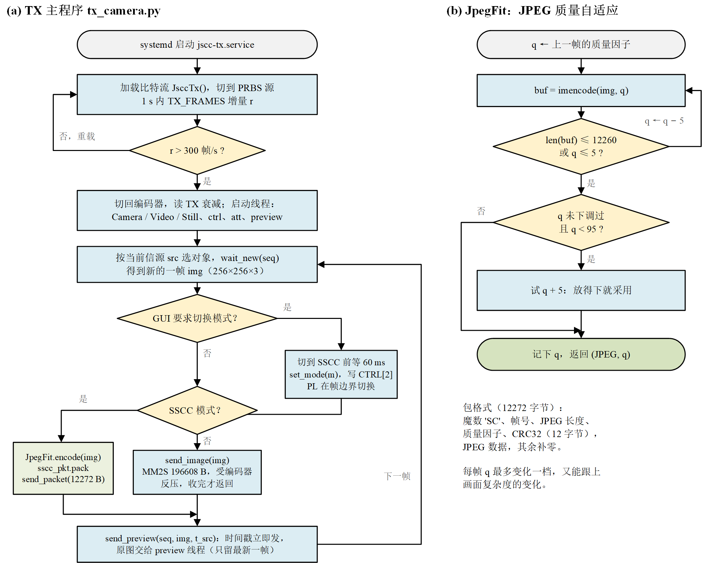

图2-18　TX主程序流程（左）与JPEG质量自适应（右）。

- 启动自检：TX板的AD9361初始化与相位扫描在PL中自动完成，需要几秒。主程序加载比特流后先切到PRBS源，1秒内发往DAC的帧计数增加超过300帧才认为DAC侧已就绪，然后切到编码器；否则重新加载，最多5次。
- 模式切换：切换到SSCC前先等60 ms，让编码器把最后一帧（约33 ms）送完，再写控制寄存器中的SSCC模式位；PL中的`frame_src_mux`也只在帧边界切换，不会出现半帧。
- JPEG质量自适应：为了公平对比，SSCC每幅图必须和DeepJSCC-Q一样只占32,768个信道符号，即JPEG码流不能超过一个包的12,260字节。JPEG的码长随画面复杂度变化，固定质量因子要么放不下、要么浪费带宽，所以每帧选择能放进包的最大质量因子：从上一帧的q开始，放不下就以5为步长下调；第一次就放得下且q < 95，则试一次q + 5。

#### 2.3.2.2 RX服务`rx_server.py`

RX服务由7个线程组成，共用一个锁保护MMIO写入和DMA（表2-13）。

表2-13　RX服务的线程

| 线程 | 周期 | 输入 | 输出 |
|---|---|---|---|
| 图像接收 | 每帧 | 图像DMA（S2MM），两个缓冲交替；图像转发设为连续模式 | 一帧196,608字节放入发送队列 |
| 图像发送 | 每帧 | 发送队列 | UDP图像消息 |
| 遥测 | 10 Hz | 遥测快照（4级 × 20个符号 × 64）、寄存器计数 | 遥测消息：状态 + 星座数组 |
| 频谱 | 2 Hz | 下一帧开始时触发抓取9,728个ADC采样 | 帧内与帧前噪声的Welch功率谱（256点，Hann窗，50 %重叠） |
| SSCC包转发 | 250 Hz轮询 | 遥测接口中的SSCC包序号与双缓冲 | SSCC包消息：12,272字节 |
| AGC记录 | 2 Hz | PHY同步帧计数、增益 | 失步 / 恢复时记录AGC寄存器快照（只读） |
| AGC看门狗 | 2 Hz | PHY同步帧计数、增益 | 必要时复位AGC（2.3.2.3节） |

PS接收图像的速度即使跟不上，丢帧也只发生在PL的URAM帧缓存（整帧丢弃），PHY不会被反压。DMA等待超时后，用AXI DMA的软复位（S2MM控制寄存器bit 2）清除挂起的传输，再重新启动通道。

#### 2.3.2.3 AD9361的PS初始化与AGC看门狗`ad9361_ps.py`

PS初始化（`AD9361.init`，图2-19左）：ADI配置工具生成的初始化序列由`lut_to_json.py`转换成JSON操作列表，操作有四种：`w`（写寄存器）、`r`（读寄存器）、`delay`（延时）和`poll`（轮询某寄存器的若干位直到等于期望值，超时报错并指出是哪一步）。执行顺序为：射频控制寄存器写001（切到PS控制，AD9361复位引脚RESETB拉低）→ 2 ms后写011（释放复位）→ 逐条执行操作 → 写111（初始化完成，PL释放AD9361一侧的FIFO，并把收发控制引脚ENABLE / TXNRX拉高）。RX的初始化放在PS，AGC等射频参数修改后可以直接上板验证，不需要重新综合。

AGC看门狗（`AgcGuard.check`，图2-19右）：AD9361的快速AGC（fast attack）[10]是为突发通信设计的：在一个包的前导期间快速调整增益并锁定，锁定后只在检测到过载、更强信号等事件时才调整；信号持续变弱时，它不会主动升高增益，而是由基带在包与包之间重新启动AGC。本作品要求AGC作为射频模块独立工作、不依赖基带信号，因此不使用基带控制的重启，而由PS在链路失步时重启：

- 每0.5 s读PL的PHY同步帧计数和当前增益索引（普通的寄存器读，不经过SPI），计算最近0.5 s的同步帧率；
- 同步率低于5帧/s、增益索引小于增益表上限，且距上次复位已超过3 s时，经SPI复位AGC状态机（AD9361的0x0FA寄存器即AGC配置1（增益控制模式），先写0x05再写0xE5）。

判据只用同步率和增益是否到顶两个量，与环境的底噪、接收功率无关；TX正常发送时同步率约30帧/s，看门狗不动作。

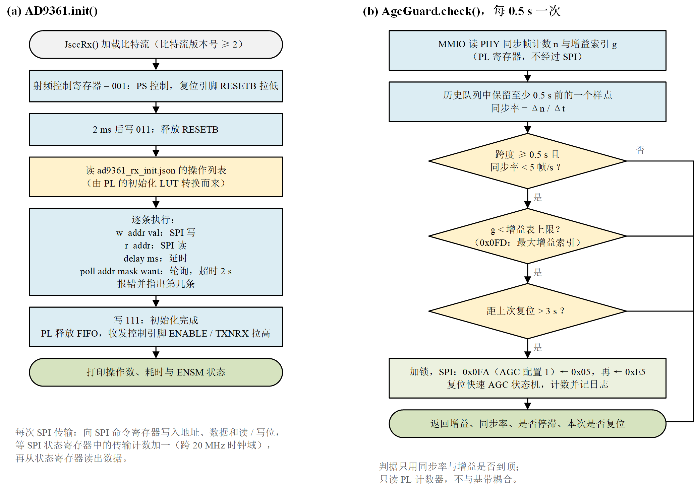

图2-19　AD9361的PS初始化（左）与AGC看门狗（右）。

#### 2.3.2.4 触摸屏GUI `jscc_gui.py`

GUI用PyQt5 + pyqtgraph编写，在RX板上全屏运行，有四个页面：

- 图像链路页：并排显示TX原图与RX重建图，给出PSNR、端到端时延和链路统计；页面上有TX衰减调节条和JSCC / SSCC、信源切换按钮；
- 物理层页（图2-20）：均衡各级的星座图与EVM、信道 |H| 随时间变化的三维曲面、逐子载波SNR、EVM历史、AGC与同步状态；
- 主题页：切换配色主题；
- 介绍页：系统框图与原理说明。

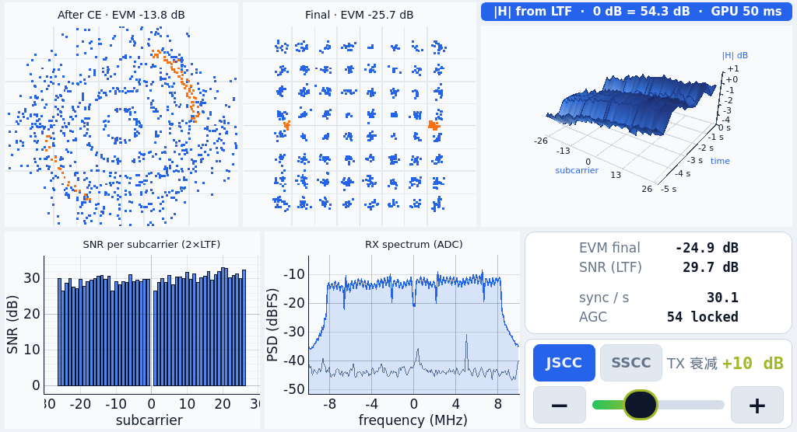

图2-20　RX板触摸屏上的物理层页（局部）：星座图、信道 |H| 三维曲面（Mali-400渲染）、逐子载波SNR与链路状态。

RX解码图没有帧号，PSNR的计算方法是：在最近350 ms收到的TX预览帧中，按1/4降采样后的均方误差找出最匹配的一帧，再算全分辨率PSNR；SSCC帧有帧号，直接配对。UDP分片的接收与重组放在独立进程中完成，只把完整消息交给GUI进程，界面绘制不受网络收包影响。

#### 2.3.2.5 Mali-400 GPU离屏三维渲染`h3d_render.py`

信道 |H| 三维曲面（52个子载波 × 最近5秒）是物理层页上最直观的一张图，由ZU5EG片上的Mali-400 MP2 GPU（1个几何处理器、2个像素处理器，500 MHz）渲染。

驱动：PYNQ-ZU镜像的内核（6.6.10-xilinx-v2024.1）没有打开开源Mali驱动lima（`CONFIG_DRM_LIMA`）及其依赖`DRM_SCHED`、`DRM_GEM_SHMEM_HELPER`，而设备树中已有符合lima要求的GPU节点（`gpu@fd4b0000`），用户态Mesa 22也带有`lima_dri.so`。因此取Xilinx linux-xlnx对应标签的`drivers/gpu/drm/{lima,scheduler}`与`drm_gem_shmem_helper.c`，在板上以外部内核模块方式编译（`src/sw/board_setup/gpu_lima/`），开机自动加载。板上内核由gcc 12编译而板上只有gcc 11，所以在一份私有的内核构建树中单独生成arm64头文件和`modpost`（不经过会重跑kconfig的顶层Makefile），并用一个编译器包装脚本去掉gcc 11不支持的编译选项。

渲染方式：板上X服务的显示驱动（armsoc）不支持GPU加速，经X的OpenGL程序只能得到软件渲染。因此三维曲面由一个独立的渲染进程绕过X、直接在lima的render节点上离屏绘制，再把像素读回交给GUI当作图片显示，界面其余部分仍由X显示（图2-21）：

1. 初始化GPU：按驱动名在`/sys/class/drm/renderD*`中找到lima的render节点，经`libgbm`创建GBM设备，用`eglGetPlatformDisplay(EGL_PLATFORM_GBM_KHR)`初始化EGL，建立OpenGL ES 2.0的无表面上下文；渲染目标是一个帧缓冲对象，RGBA纹理作颜色附件，16位深度渲染缓冲作深度附件。
2. 生成几何（NumPy，约7 ms）：T×N的 |H| 历史（N = 52，T为最近5 s的快照）构成三角网格；法向量由有限差分得到，按Lambert模型着色，颜色按 |H| 在三段色图中插值；另有曲面网格线、地面网格和坐标轴的线段。
3. 绘制：一个只做MVP变换的顶点着色器加一个直通片元着色器；先画曲面（开启多边形偏移，使网格线浮在曲面上），再画线段；相机参数与PC版pyqtgraph的视角一致。
4. 读回：`glReadPixels`读回RGBA图像，约45 ms；投影矩阵预先在y方向翻转，读回的数据已是“首行在上”，不需要再翻转。
5. 与GUI通信：GUI中的一个工作线程经标准输入、输出与渲染进程交换数据，请求包含图像尺寸和 |H| 数组，响应包含渲染耗时和像素；同一时刻最多一个请求在途，新数据直接覆盖未发出的旧请求。坐标轴的刻度文字由Qt绘制，用同一个`camera()`和`project()`函数把三维坐标投影到像素，与GPU画出的坐标轴对齐。

没有lima驱动时，GUI自动改用二维瀑布图。每帧渲染加读回约60 ms，曲面每秒刷新2.5次，渲染进程约占一个CPU核的10 %，`rx_server.py`保持每秒接收30帧。

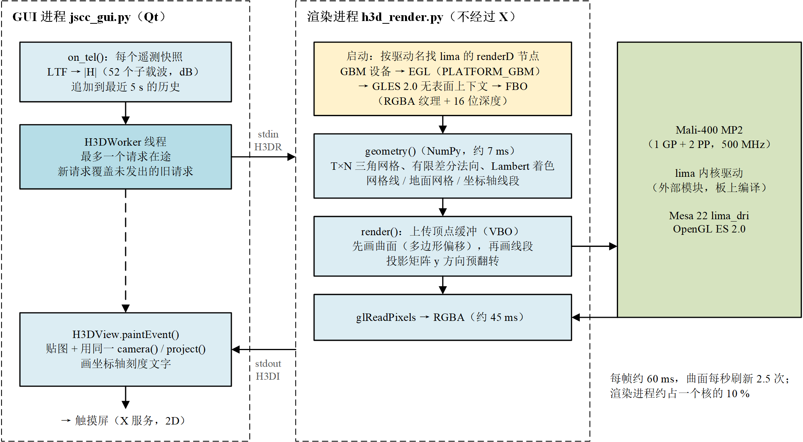

图2-21　Mali-400离屏渲染：GUI进程、渲染进程与GPU之间的数据流。

#### 2.3.2.6 PC端工具链

PC端工具链从训练一直延伸到上板测量（图2-22），各环节之间都以文件交接。

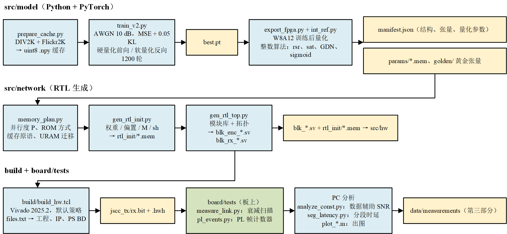

图2-22　PC端工具链：模型训练 → 整数量化 → RTL生成 → 比特流 → 测量。

模型与训练（`src/model/`）：

- 模型配置：神经网络按DeepJSCC-Q期刊版本[2]实现，主通道数C = 32，潜变量通道数16，总下采样倍率4。256×256 RGB图像编码为64×64×16的潜变量，相邻通道配为I/Q，每帧32,768个64QAM符号，带宽比为每像素0.5个复符号。
- 训练目标：在10 dB AWGN信道下训练，损失为重构均方误差加权重0.05的星座分布KL正则，

  ```math
  \mathcal L=\mathrm{MSE}(\mathbf x,\hat{\mathbf x})+0.05\,D_{\mathrm{KL}}(p\,\|\,u)
  ```

  其中p为批次内软分配的平均星座概率，u为均匀分布。

- 量化方式：前向用最近星座点的硬量化，反向通过距离softmax的软量化传递梯度（`hard + soft - soft.detach()`）。训练前向与部署时的符号集合一致，编码器又能得到可用的梯度；KL项防止符号使用概率过度集中。
- 训练数据：DIV2K[13] train 800张 + Flickr2K[14] 2650张；优化器Adam，学习率2×10⁻⁴，有效批量16，共训练1200轮，部署检查点为第1186轮。

整数量化与导出：`export_fpga.py`对浮点检查点做W8A12训练后量化，卷积权重为逐输出通道缩放的8位整数，激活为逐张量缩放的12位整数；`int_ref.py`规定偏置、舍入、饱和与非线性的整数算法，是RTL的逐比特参考。导出的`manifest.json`包含神经网络结构、张量形状、量化参数和存储规划，`gen_rtl_init.py`、`gen_rtl_top.py`据此生成RTL（2.2.3.1节）。量化损失在两个数据集上都不超过0.07 dB（表2-14）。

表2-14　软件模型的量化精度（10 dB AWGN，同一噪声样本）

| 评估集 | 浮点PSNR / dB | W8A12 PSNR / dB | 损失 / dB |
|---|---:|---:|---:|
| DIV2K验证集（256×256中心裁剪） | 31.27 | 31.22 | 0.052 |
| Kodak[15]（原分辨率） | 32.65 | 32.59 | 0.062 |

构建与测量：`build/build_hw.tcl`按`src/hw/<tx|rx>/files.txt`新建工程、加入IP、生成PS块设计，用Vivado 2025.2默认策略完成综合、实现和比特流生成。`board/tests/`中的测量脚本完成链路扫描（`measure_link.py`）、数据辅助SNR计算（`analyze_const.py`）和基于PL帧计数器的分段时延测量（`pl_events.py`、`seg_latency.py`），结果见第三部分。

# 第三部分  完成情况及性能参数

## 3.1 整体介绍

系统实物见图3-1（正面）与图3-2（斜45°）：左侧为RX板（PYNQ-ZU + AD-FMCOMMS3 + 1024×600触摸屏），右侧为TX板（PYNQ-ZU + AD-FMCOMMS3 + USB摄像头），两块子卡各接一根915 MHz天线（TX板接发射口，RX板接接收口）。两块板上电约1分钟后自动建立链路，触摸屏实时显示重建图像与物理层状态；测试在室内进行，信道SNR通过TX的AD9361衰减调节。

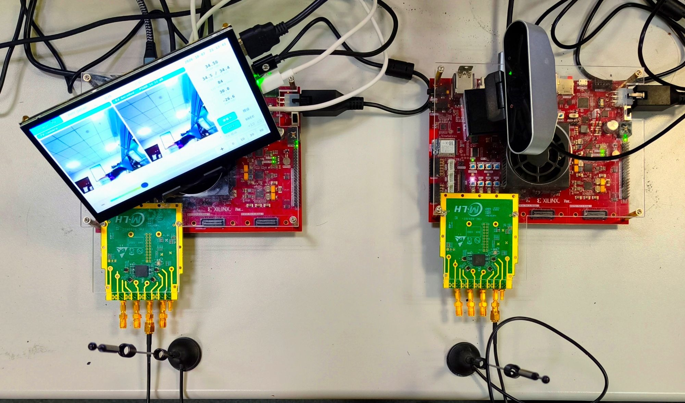

图3-1　系统实物（正面）。

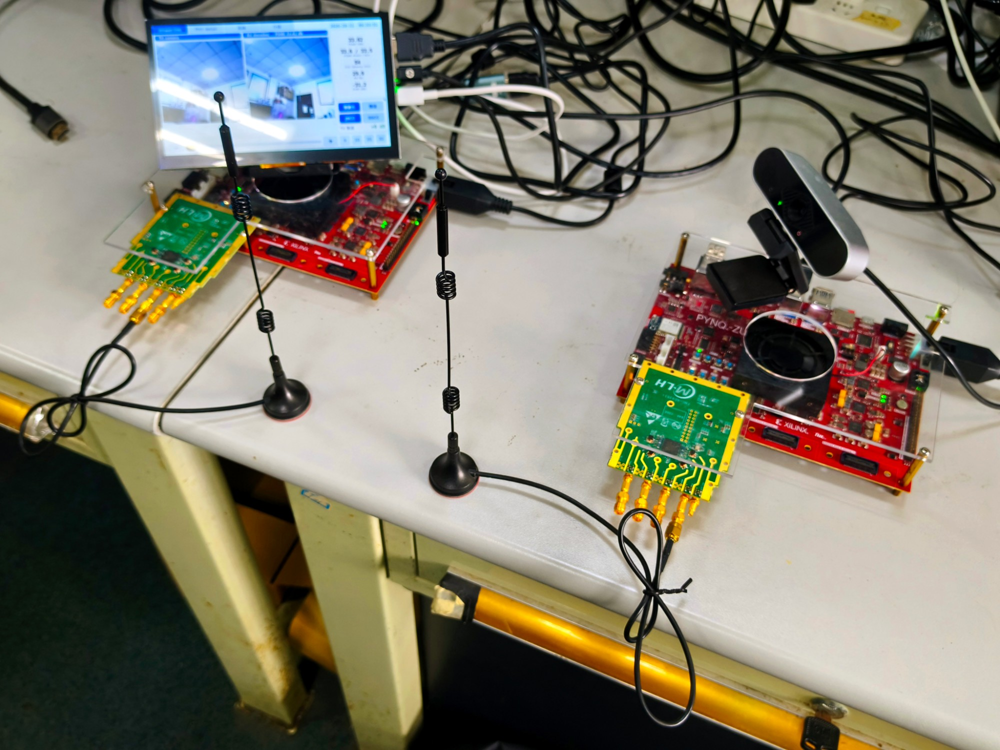

图3-2　系统实物（斜45°）。

## 3.2 工程成果

### 3.2.1 机械成果

本作品没有机械结构。

### 3.2.2 电路成果

两块板分别加载TX、RX比特流，均用Vivado 2025.2的默认策略从仓库源码重建，时序全部收敛（表3-1）。

表3-1　完整工程的资源、时序与功耗（xczu5eg-sfvc784-2-e，布局布线后）

| 工程 | LUT | FF | BRAM36 | URAM | DSP | WNS / WHS (ns) | 片上功耗 |
|---|---|---|---|---|---|---|---|
| TX | 52,666（45.0 %） | 53,335（22.8 %） | 104.5（72.6 %） | 10（15.6 %） | 243（19.5 %） | +0.151 / +0.010 | 4.49 W |
| RX | 70,768（60.4 %） | 76,845（32.8 %） | 123.5（85.8 %） | 25（39.1 %） | 394（31.6 %） | +0.234 / +0.010 | 4.94 W |

功耗为Vivado在布局布线后的估算值，其中PS各占2.733 W。按模块划分：

- 神经网络核（OOC综合）：编码器46,054 LUT、233 DSP、100 BRAM36、4 URAM；解码器50,178 LUT、312 DSP、100 BRAM36、18 URAM；
- OFDM物理层：TX约2.9 k LUT、3 BRAM36、6 URAM；RX约11.0 k LUT、12 BRAM36、6 URAM、82 DSP；
- 其余为SSCC基线、AD9361接口、PS接口与遥测。

神经网络在250 MHz下运行，承担每帧2.33 GMAC的名义卷积工作量，编码器、解码器分别只用233和312个DSP，占各自器件的19 %和25 %。

### 3.2.3 软件成果

RX板的触摸屏GUI有图像链路页（图3-3）和物理层页（图3-4）。图像链路页并排显示TX原图与RX重建图，右侧给出实时PSNR、端到端时延、接收帧率和EVM，下方是TX衰减调节条，并可切换信源（摄像头 / 预设图 / 演示视频）和传输方案（JSCC / SSCC）；图3-3为TX额外衰减20 dB时的屏幕截图。物理层页实时显示四级均衡星座图、信道 |H| 三维曲面（Mali-400渲染）、逐子载波SNR、接收频谱和链路状态。

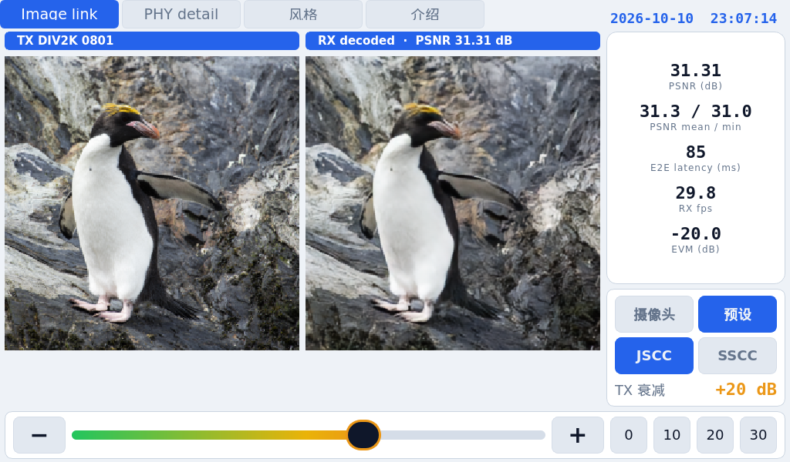

图3-3　RX板触摸屏GUI（图像链路页，DIV2K 0801预设图，TX额外衰减20 dB）。


图3-4　RX板触摸屏GUI（物理层页）。

PC端训练程序的结果见图3-5：神经网络在10 dB AWGN信道下训练1200轮，训练集与验证集（DIV2K验证集100张，256×256中心裁剪）的MSE同步下降，没有过拟合；验证集指标连续20轮不提升时学习率降为原来的0.8倍，从2×10⁻⁴逐步降到1.7×10⁻⁵。验证集PSNR在第1186轮达到最高的31.28 dB（Kodak 32.65 dB），即部署使用的检查点。

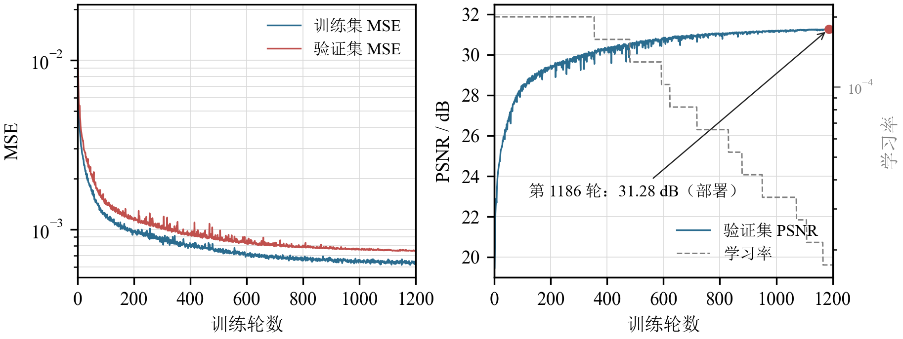

图3-5　神经网络训练曲线（10 dB AWGN）：左为训练集与验证集MSE，右为验证集PSNR与学习率。

## 3.3 特性成果

### 3.3.1 功能验证

表3-2　功能验证结果

| 对象 | 方法 | 结果 |
|---|---|---|
| 编码器、解码器RTL | 与整数参考模型逐拍比较数据与边界标记，输入valid概率90 %、输出ready概率80 % | 各2帧逐比特一致 |
| 神经网络量化 | W8A12与浮点模型对比（10 dB AWGN，表2-14） | PSNR损失0.052 dB（DIV2K）/ 0.062 dB（Kodak） |
| OFDM物理层RTL | RTL发射机输出 + ±40 ppm SFO、20 kHz CFO、多径、30 dB SNR | 683个符号的长帧内SFO跟踪与理论漂移一致 |
| OFDM物理层（板上） | PRBS 64QAM源代替编码器，板上满速连续运行 | 7.15×10⁸ 个未编码比特0误码；EVM帧头 −36.6 dB、帧尾 −34.9 dB |
| 整机 | 摄像头 / 演示视频 / 预设图经空口传输，GUI实时显示 | 30 fps稳定运行（3.3.3节） |

帧尾与帧头的EVM只差1.7 dB，说明SFO / CPE跟踪在683个OFDM符号的长帧内有效。

### 3.3.2 画质与SNR

测试条件：

- TX播放DIV2K 0802预设图（256×256），DeepJSCC-Q与SSCC使用同一物理层、同一星座电平与TX衰减设置，每幅图同样32,768个符号；
- 从最大衰减往小扫描，每点稳定3 s后测8 s；
- 横轴为数据辅助SNR：静止图像下每帧发送的符号相同，以最强点所有快照平均后的判决作为参考星座，$`\mathrm{SNR}=10\log_{10}\overline{|\mathrm{ref}|^2}/\overline{|\mathrm{rx}-\mathrm{ref}|^2}`$；
- SSCC帧CRC错误但JPEG仍可解码时按实际重建图计分，无法解码时按中灰图计分。

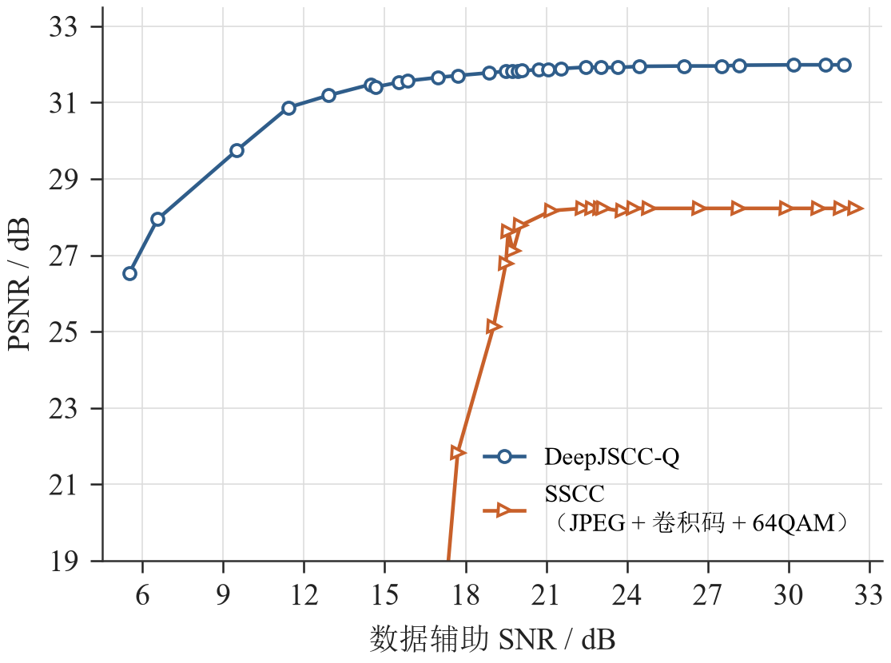

图3-6　PSNR–SNR实测曲线（DIV2K 0802）。

表3-3　DeepJSCC-Q的实测PSNR

| 数据辅助SNR / dB | 32.1 | 22.5 | 19.7 | 17.0 | 14.5 | 9.5 | 5.5 |
|---|---|---|---|---|---|---|---|
| PSNR / dB | 31.99 | 31.93 | 31.82 | 31.66 | 31.48 | 29.75 | 26.54 |

表3-4　SSCC基线的实测PSNR与CRC正确率

| 数据辅助SNR / dB | 32.5 | 21.2 | 20.0 | 19.5 | 19.0 | 17.7 | 16.7 |
|---|---|---|---|---|---|---|---|
| PSNR / dB | 28.23 | 28.17 | 27.78 | 26.78 | 25.12 | 21.83 | 13.88 |
| CRC正确率 | 1.00 | 0.99 | 0.96 | 0.83 | 0.65 | 0.40 | 0.02 |

- 在相同的每图32,768个符号下，DeepJSCC-Q在高SNR时PSNR比SSCC高3.8 dB（31.99 dB对28.23 dB）；
- DeepJSCC-Q从32 dB到5.5 dB平缓退化，PSNR共下降5.5 dB，SNR低于17 dB后仍持续输出可辨认的图像；
- SSCC在SNR约20.0 → 16.7 dB的3 dB区间内，PSNR从27.8 dB跌到13.9 dB（CRC正确率0.96 → 0.02），再往下重建图严重损坏，PSNR只有8–10 dB。

相同TX衰减下两种方案的代表帧见图3-7，DeepJSCC-Q在三个SNR下解码器收到的软符号见图3-8。低SNR时星座点已无法分辨，但解码器仍能重建可辨认的图像，这正是不做星座判决、把连续I/Q直接送入解码器的效果。

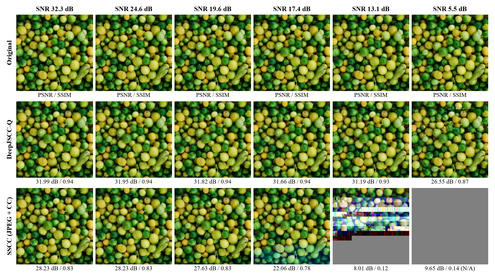

图3-7　相同TX衰减下的代表解码图像（上：原图；中：DeepJSCC-Q；下：SSCC），列标题为两种方案实测SNR的均值，图下为单帧PSNR / SSIM，N/A表示无法解码、按中灰图计分。

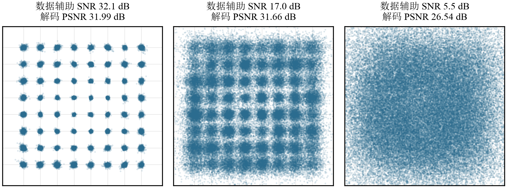

图3-8　DeepJSCC-Q解码器输入端的接收星座（均衡输出，48个数据子载波）。

### 3.3.3 帧率与时延

帧率：DeepJSCC-Q播放演示视频连续运行10 min，RX在600.06 s内收到18,000帧，平均30.0 fps（图3-9）。

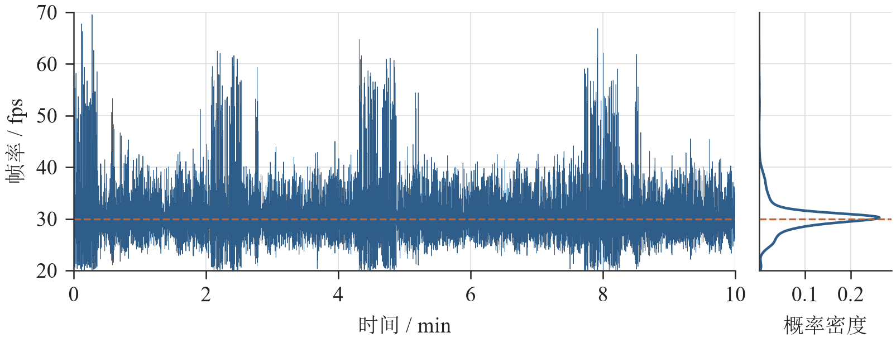

图3-9　连续10 min的接收帧率（DeepJSCC-Q，演示视频）。

分段时延：两块板的PS高频轮询PL中按数据流位置分布的帧计数器（TX：编码器输入字节、编码器输出帧、发射帧；RX：同步、PHY输出帧、解码完成帧），按帧配对，两板时钟偏差用往返时间估计并线性插值校正（往返时间中位数0.58 ms）。按文献[3]的三段划分，结果见表3-5与图3-10。

表3-5　分段时延（PL计数器）

| 段 | 起点 → 终点 | 中位数 | 1 % / 99 %分位 |
|---|---|---|---|
| 编码 | 第一个图像字节进入编码器 → 最后一个符号输出 | 38.20 ms | 38.15 / 38.25 ms |
| 传输 | 最后一个编码符号 → RX最后一个PHY符号输出（帧缓存、空口、同步、均衡） | 2.87 ms | 2.81 / 2.94 ms |
| 解码 | RX最后一个PHY符号 → 最后一个解码字节 | 30.39 ms | 30.34 / 30.48 ms |
| PL合计 | | 71.47 ms | 71.39 / 71.55 ms |

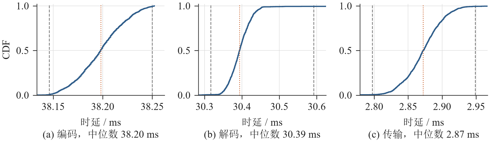

图3-10　分段时延的累积分布（编码段1706个样本，其余各段1701个）。传输段的下限2.748 ms即一帧的空中时间。

编码段38.2 ms长于帧间隔33.3 ms，是因为编码器是逐层流水的：下一帧的输入在上一帧尚未输出完时就已开始，吞吐由最慢的一层决定（30 fps），单帧时延则是各层流水填充时间之和。从TX应用取得源帧到RX收到完整重建图（不含屏幕显示），端到端时延中位数为81.74 ms（17,656个样本）。

### 3.3.4 射频前端相对开源基线的改进

AD9361的接口与初始化部分来自开源工程与ADI配置工具（2.2.3节），本作品在其基础上做了三项修改：修正SPI握手、在PL中实现TX正交校准相位扫描、重新设计可编程FIR。表3-6为单板环回测量（物理层比特链路阶段，16QAM）的结果。

表3-6　单板环回EVM与镜像抑制

| 配置 | EVM | 镜像（I/Q失衡） |
|---|---|---|
| 开源工程 + 配置工具默认设置 | −22.0 dB | −25.7 dBc |
| 修正SPI握手 | −29.7 dB | −36.5 dBc |
| + TX正交校准相位扫描 | −31.2 dB | −38.7 dBc |
| + 可编程FIR重新设计（最终版本，另含数字功率回退） | −32.0 ~ −32.2 dB | −38 dBc |

FIR重新设计后，冲激响应在 ±8个采样之外的能量从 −24.7 dB降到 −44.8 dB（配置工具默认的128抽头FIR振铃超出CP）。快速AGC的寄存器取值参考openwifi[12]，其中锁定电平改为 −14 dBFS：SSCC波形没有星座熵约束，PAPR尾部比DeepJSCC-Q高约0.8 dB，在openwifi的 −12 dBFS锁定电平下会触发ADC大过载，使已锁定的快速AGC在帧内改变增益（表3-7）。

表3-7　AGC锁定电平对SSCC的影响

| 指标 | −12 dBFS（openwifi取值） | −14 dBFS（本作品） |
|---|---|---|
| SSCC帧内增益跳变的帧 | 9 / 45 | 0 / 44 |
| 数据辅助SNR（各衰减点） | — | 提高0.1 ~ 1.9 dB |

PN符号翻转使OFDM的PAPR（99 %分位）从10.1–10.7 dB降到9.4–9.8 dB，与随机64QAM相当；三张测试图的TX时域峰值最大为1765（满量程2047），不削顶。

### 3.3.5 与DeepJSCC-Q原网络的对比

DeepJSCC-Q论文[2]的网络（Fig. 3）主通道数为256，编码器有4个步长为2的残差块，总下采样16倍。本作品为了在单片xczu5eg上以30 fps运行，在保持潜变量元素数（即每幅图的信道符号数）不变的前提下修改了网络规模，修改及理由见表3-8。

表3-8　部署网络相对DeepJSCC-Q原网络的修改

| 项 | 原网络[2] | 本作品 | 理由 |
|---|---|---|---|
| 主通道数C / 输出通道数Cout | 256 / 256 | 32 / 16 | 权重与乘加数随通道数平方增长，原网络的权重放不进片上存储（见下文） |
| 下采样倍率 | 16（4个步长2的残差块） | 4（前2个步长2，后2个步长1） | 通道数减少后，增大潜变量的空间尺寸，保持潜变量元素数不变 |
| 解码器上采样 | 4个RU块各放大2倍 | 前2个RU倍率为1，后2个放大2倍 | 与编码器对称 |
| 潜变量 / 带宽比 | 16×16×256，ρ = 1/6 | 64×64×16，ρ = 1/6 | 二者都是65,536个实数（32,768个复符号），信道使用量相同 |
| LeakyReLU斜率 | 论文未注明 | 1/128 | 负半轴只需右移7位，不用乘法器 |
| 数值精度 | 浮点 | W8A12训练后量化 | 片上存储与DSP位宽；量化损失0.06 dB（表2-14） |

残差块、GDN / IGDN、注意力块、PixelShuffle与软硬量化训练方法均与原网络相同。按同一计数方法（每个卷积输出元素计K·K·C_in次乘加，含零填充位置），256×256输入时两种网络的规模见表3-9。

表3-9　原网络与部署网络的规模（256×256输入，计算值）

| 项 | 原网络（C = 256） | 本作品（C = 32） | 比值 |
|---|---:|---:|---:|
| 编码器乘加 / 帧 | 47.70 GMAC | 0.913 GMAC | 1/52 |
| 解码器乘加 / 帧 | 70.48 GMAC | 1.417 GMAC | 1/50 |
| 编码器参数 | 10,833,408 | 141,584 | 1/77 |
| 解码器参数 | 23,599,224 | 245,704 | 1/96 |
| 编码器卷积权重（8位存储） | 10.6 MB | 137 KB | — |
| 解码器卷积权重（8位存储） | 23.4 MB | 241 KB | — |

xczu5eg的片上存储共约2.95 MB（144块BRAM36与64块URAM），原网络仅编码器的8位权重就有10.6 MB，只能放在片外DDR中逐层读取；原网络编码器在30 fps下需要1.43 TMAC/s，而全部1248个DSP在250 MHz下每秒只能完成0.31 TMAC。缩小后，编码器、解码器的全部权重与激活缓存都放在片上，乘加需求降到原网络的约1/51。

代价是画质。论文Fig. 12给出了与本作品完全相同的工作点：Kodak测试集、64-QAM、λ = 0.05、训练与测试SNR均为10 dB、ρ = 1/6，原网络的PSNR约为34.9 dB（逐图PSNR的平均）。本作品的浮点模型在相同条件下逐图平均PSNR为33.26 dB（24张图，每张10次噪声），低约1.6 dB。这一差值还包含训练数据的差异：原网络用ImageNet[16]（约120万张）训练，本作品用DIV2K与Flickr2K（3450张）训练。

### 3.3.6 与FPGA实现的DeepJSCC对比

与本作品最接近的公开FPGA工作是Isobe等人在GLOBECOM 2025发表的DeepJSCC实时5G图像传输系统[3]，对比见表3-10。

表3-10　与文献[3]的对比

| 项 | Isobe等[3] | 本作品 |
|---|---|---|
| 神经网络 | 5层卷积 / 5层转置卷积 | DeepJSCC-Q：残差、GDN / IGDN、注意力、PixelShuffle，55 / 59个卷积算子 |
| 每像素复符号数 | 0.25 | 0.5 |
| 名义卷积工作量 | 0.222 GMAC/帧 | 2.330 GMAC/帧（10.5倍） |
| 数值精度 / 实现 | INT8，HLS | W8A12，RTL生成器 |
| 器件 | ZCU111（XCZU28DR） | 2 × xczu5eg |
| 编码器资源 | 77,902 LUT / 1,597 DSP / 1,038.5 BRAM | 46,054 LUT / 233 DSP / 100 BRAM36 + 4 URAM |
| 解码器资源 | 28,179 LUT / 874 DSP / 1,011.5 BRAM | 50,178 LUT / 312 DSP / 100 BRAM36 + 18 URAM |
| 物理层 | 5G系统（外部设备） | 自研OFDM物理层，与神经网络在同一PL中 |
| 帧率 | 约33 fps | 30 fps |
| 时延 | 编码39.6 / 解码52.9 ms（含PS处理） | 编码38.2 / 解码30.4 ms（PL计数器） |
| 功耗 | 编码器7.757 W / 解码器5.689 W | TX 4.49 W / RX 4.94 W（估算，含PS与物理层） |

按同一名义MAC定义计算，本作品编码器、解码器的工作量分别是[3]的8.23倍和12.78倍，而编码器DSP只用[3]的15 %、解码器用36 %，BRAM都约为[3]的1/10。两者的器件、数值精度、物理层和功耗测量方法不同，表中只说明各自条件下的结果；资源列用绝对数量，不比较占用率；[3]的时延含PS处理，本作品的分段时延只含PL。

# 第四部分  总结

## 4.1 可扩展之处

1. 信道自适应：目前模型只在10 dB下训练。可以训练多个SNR或带宽比的模型并按GUI测得的SNR切换，或把SNR作为神经网络的输入，进一步提高高SNR时的画质。
2. 更高分辨率：神经网络是全卷积的，可以把大图分块传输，或在更大器件上增加行缓存宽度。
3. 学习星座：论文中可学习的L-64星座优于固定64QAM，接收端不做判决，只需修改TX的星座映射。
4. 移动与多天线：利用均衡后逐子载波的SNR做加权，或扩展到AD9361的2×2 MIMO，提高衰落信道下的鲁棒性。
5. 双向链路：两块板都有完整收发通道，可以实现双向实时图像传输。

## 4.2 心得体会

这个作品让我们体会最深的是，“把神经网络放到FPGA上”和“让它在真实无线链路上工作”是两件难度相当的事。

神经网络部分，最初按论文的256通道结构估算，权重有三千多万个，片上存储差了一个数量级。我们没有选择把权重放在DDR里，而是保持潜变量数不变、减少通道和下采样，让整网权重和缓存都留在片上，再按层选择最小并行度。这一步的关键是在写RTL之前就逐个实例计算BRAM：不同层的宽深比、端口数都不同，按总容量估算会严重低估实际用量。权重ROM用顺序读加位宽转换的组织方式，也是在逐层核对BRAM列宽时发现，并行度不必是9的倍数。整数参考模型从一开始就规定了每一步的舍入和饱和，RTL逐个模块与它逐比特比较，问题能在仿真阶段定位到具体模块。

物理层部分，DeepJSCC的接收端不做判决，帧尾的相位旋转、定时漂移会直接进入解码器，所以对同步和跟踪的要求比比特链路更高。683个OFDM符号的长帧让我们必须按晶振标称精度的最坏情况设计SFO跟踪，而不能只看两块板实测的频偏。射频前端的问题往往不在算法里：SPI握手错位使校准提前结束，快速AGC在信号变弱时停在低增益，SSCC的峰值触发ADC过载。这些问题都是靠抓取原始ADC数据、读取寄存器状态、一次只改一个参数逐步定位的。

测量口径也很重要。最初用PS的时间戳测时延，结果混入了Linux调度的抖动；改为在PL中放置帧计数器、按数据流位置分段统计后，各段时延的分布都非常集中，也能和文献[3]按同样的三段划分对比。

整个项目是参赛者与两个AI编程代理（Claude Code与Codex）协作完成的。AI代理承担了大量代码编写、调试脚本、数据分析和文档工作，速度远超人工；参赛者负责提出目标与约束、做关键技术判断、决定取舍，并完成接线、上电、观察等物理操作。协作中AI反复出现的问题是：没有证据就下结论、把自己定的经验值当成规格、没有问清约束就增加设计、只读了部分资料就引用。针对这些问题，我们约定了“改动要小而有判据、一次只改一处、先定验证标准再动手、不做不必要的RTL修改”等规则，并写进代理的记忆和交接文档。几个关键判断，例如LTF定时门限按半采样相关峰损失确定、AGC不与基带耦合、时延必须用PL计数器测量、并行度不受BRAM位宽限制，都来自参赛者对AI方案的追问。协作记录与从中提炼的技能见附录A、附录B。

# 第五部分  参考文献

[1] E. Bourtsoulatze, D. B. Kurka, D. Gündüz. Deep joint source-channel coding for wireless image transmission[J]. IEEE Transactions on Cognitive Communications and Networking, 2019, 5(3): 567-579. DOI: 10.1109/TCCN.2019.2919300.

[2] T.-Y. Tung, D. B. Kurka, M. Jankowski, D. Gündüz. DeepJSCC-Q: Constellation constrained deep joint source-channel coding[J]. IEEE Journal on Selected Areas in Information Theory, 2022, 3(4): 720-731. DOI: 10.1109/JSAIT.2022.3231042.

[3] T. Isobe, et al. FPGA-based deep joint source-channel coding for real-time 5G image transmission[C]// GLOBECOM 2025 - 2025 IEEE Global Communications Conference. Taipei, 2025: 1232-1237. DOI: 10.1109/GLOBECOM59602.2025.11432434.

[4] J. Ballé, V. Laparra, E. P. Simoncelli. Density modeling of images using a generalized normalization transformation[C]// International Conference on Learning Representations (ICLR). 2016.

[5] Z. Cheng, H. Sun, M. Takeuchi, J. Katto. Learned image compression with discretized Gaussian mixture likelihoods and attention modules[C]// IEEE/CVF Conference on Computer Vision and Pattern Recognition (CVPR). 2020: 7939-7948. DOI: 10.1109/CVPR42600.2020.00796.

[6] W. Shi, J. Caballero, F. Huszár, et al. Real-time single image and video super-resolution using an efficient sub-pixel convolutional neural network[C]// IEEE Conference on Computer Vision and Pattern Recognition (CVPR). 2016: 1874-1883.

[7] IEEE Std 802.11-2020. IEEE Standard for Information Technology—Telecommunications and Information Exchange between Systems—Local and Metropolitan Area Networks—Specific Requirements—Part 11: Wireless LAN Medium Access Control (MAC) and Physical Layer (PHY) Specifications[S]. New York: IEEE, 2021.

[8] T. M. Schmidl, D. C. Cox. Robust frequency and timing synchronization for OFDM[J]. IEEE Transactions on Communications, 1997, 45(12): 1613-1621. DOI: 10.1109/26.650240.

[9] M. Speth, S. A. Fechtel, G. Fock, H. Meyr. Optimum receiver design for wireless broad-band systems using OFDM—Part I[J]. IEEE Transactions on Communications, 1999, 47(11): 1668-1677.

[10] Analog Devices. AD9361 reference manual: UG-570 Rev. A[Z/OL]. (2015-06)[2026-10-11]. https://www.analog.com/media/en/technical-documentation/user-guides/ad9361.pdf.

[11] Analog Devices. no-OS: software drivers for systems without an operating system[CP/OL]. (2026-10-09)[2026-10-11]. https://github.com/analogdevicesinc/no-OS.

[12] X. Jiao, W. Liu, M. Mehari, M. Aslam, I. Moerman. openwifi: a free and open-source IEEE802.11 SDR implementation on SoC[C]// 2020 IEEE 91st Vehicular Technology Conference (VTC2020-Spring). Antwerp, Belgium, 2020: 1-2. DOI: 10.1109/VTC2020-Spring48590.2020.9128614.

[13] E. Agustsson, R. Timofte. NTIRE 2017 challenge on single image super-resolution: Dataset and study[C]// IEEE Conference on Computer Vision and Pattern Recognition Workshops (CVPRW). 2017: 126-135.

[14] R. Timofte, E. Agustsson, L. Van Gool, et al. NTIRE 2017 challenge on single image super-resolution: Methods and results[C]// IEEE Conference on Computer Vision and Pattern Recognition Workshops (CVPRW). 2017: 114-125.

[15] Eastman Kodak. Kodak lossless true color image suite[DB/OL]. [2026-10-11]. http://r0k.us/graphics/kodak/.

[16] J. Deng, W. Dong, R. Socher, L.-J. Li, K. Li, L. Fei-Fei. ImageNet: A large-scale hierarchical image database[C]// IEEE Conference on Computer Vision and Pattern Recognition (CVPR). 2009: 248-255. DOI: 10.1109/CVPR.2009.5206848.

[17] G. K. Wallace. The JPEG still picture compression standard[J]. IEEE Transactions on Consumer Electronics, 1992, 38(1): xviii-xxxiv.

[18] lzk2211. Zedboard_AD9361_radar[CP/OL]. (2025-01-11)[2026-10-11]. https://github.com/lzk2211/Zedboard_AD9361_radar.

[19] Analog Devices. HDL libraries and projects[CP/OL]. (2026-10-09)[2026-10-11]. https://github.com/analogdevicesinc/hdl.

[20] AMD. AMD Ross agentic AI assistant[CP/OL]. [2026-10-11]. https://github.com/xilinx/ross-ai-assistant.

# 附录

## 附录A大模型协作记录

本作品由参赛者与两个AI编程代理协作完成：Claude Code（Anthropic）与Codex（OpenAI）。代理在本机与两块板卡上读写代码，运行Vivado、仿真和板上程序，采集数据并出图；参赛者提出目标和约束、做关键技术判断、决定取舍，并完成接线、上电、观察LED / 屏幕 / 天线等全部物理操作。完整记录见仓库`report/llm_collab/`。

表A-1　分工与时间线（2026年）

| 时间 | 工作 | 代理 |
|---|---|---|
| 09-01 – 09-26 | DeepJSCC原型；DeepJSCC-Q按期刊版重写、训练；类802.11a OFDM发射机 | Codex |
| 09-25 – 09-28 | AD9361配置调试；OFDM自环到两板空口；AGC、定时门限、长帧SFO跟踪、遥测GUI | Claude Code |
| 09-28 – 09-29 | 1200轮训练；定点方案；存储规划；行缓存与卷积引擎RTL | Claude Code |
| 09-29 – 09-30 | 神经网络RTL生成器、FIFO定尺寸、逐比特验证、编 / 解码器工程 | Codex |
| 09-30 – 10-05 | 物理层与神经网络对接；PYNQ上板；摄像头、GUI、Mali-400 GPU；SSCC基线 | Claude Code |
| 10-05 – 10-07 | 演示视频（代理控制两块板卡、配音、剪辑）；AGC看门狗；实测；开源仓库 | Claude Code |
| 10-07 – 10-11 | 设计报告：Codex起草神经网络部分初稿并交叉审查；Claude Code撰写、绘图，参赛者逐条批注修改 | 两者 |

与本项目相关的会话共40个，用户消息766条。`report/llm_collab/cases.md`整理了17个典型案例，每个案例写明背景、模型做了什么、用户做了什么和结果，代表性的几类见表A-2。

表A-2　协作案例（摘选）

| 类型 | 案例 | 结果 |
|---|---|---|
| 参赛者给出关键判断，AI计算与实现 | LTF定时门限按半采样相关峰损失确定；SSCC在悬崖区的增益跳变来自PAPR与ADC过载 | 门限0.375用移位相加实现；AGC锁定电平改为−14 dBFS |
| 参赛者追问依据，纠正AI的错误前提 | 并行度不必受BRAM位宽限制；对openwifi配置的引用不完整 | 加入位宽转换后DSP与BRAM同时下降；补齐漏抄的AGC寄存器 |
| 参赛者约束模块边界 | AGC属于射频模块，不依赖基带；帧缓存归物理层，神经网络不重复设置 | AGC不与基带耦合；神经网络两端改为带反压的AXI-Stream |
| 参赛者纠正测量口径 | PS调度抖动不应计入FPGA的时延与帧率 | 改为PL计数器分段时延 |
| AI发现问题 | SPI握手错位；量化器多乘了一个系数（由参赛者观察到的训练曲线异常引出） | 校准恢复正常；重新训练 |
| 两个代理交叉审查 | Codex审查报告初稿，提出21条意见，其中包括Claude Code写下的过度结论和无出处数值 | 逐条处理，处理记录见`report/llm_collab/claude_codex/` |

AI反复出现的问题有四类：没有证据就下结论；把自己定的经验值当成规格；没有问清约束就增加设计；只读了部分资料就引用。对应的协作约定是：改动要小而有判据，一次只改一处，先定验证标准再动手，不做不必要的RTL修改。这些约定写进了代理的记忆与交接文档，在后续工作中持续生效。会话全文的脱敏转写及生成脚本见`report/llm_collab/transcripts/`与`report/llm_collab/tools/`。

## 附录B技能包

从开发过程中提炼了5个面向PYNQ / Zynq UltraScale+用户的通用技能（仓库`skill/`），不依赖本作品的硬件设计。格式参照AMD官方的AMD Ross Agentic AI Assistant[20]中的技能：Agent Skills格式（`SKILL.md`），正文是写给AI代理的操作手册，包括触发条件、适用与不适用场景、DO / DON'T与取自真实失败的反例、带检查点的分步流程，以及暂停点：加载内核模块、安装或停止服务、重启、修改系统配置、只要求检查时修改用户代码，这些操作之前代理必须等待用户确认；用户已经明确要求、可撤销且不影响整个系统的操作则直接执行，事后说明（表B-1）。只适用于本系统的经验（AD9361配置、杂散排查、时延测量等）和踩坑清单另存于`report/notes/project_skills/`。

表B-1　技能包

| 技能 | 解决的问题 | 附带文件 |
|---|---|---|
| `mali400-offscreen-gles` | ZU EG/EV片上Mali-400 GPU在PYNQ下无驱动、X中只有软件渲染：判断能否使用开源lima驱动，排除走不通的渲染路径，用GBM + EGL在Python中离屏渲染GLES2 | 探测脚本、渲染模板 |
| `pynq-out-of-tree-kernel-module` | 镜像内核未开启的驱动在板上补编为外部模块；内核与板上gcc版本不一致时不破坏系统构建树 | 头文件与modpost生成脚本、编译器包装 |
| `pynq-systemd-autostart` | 程序上电自启：排在加载base.bit的`bootpy.service`之后、使用PYNQ venv、等待X与外设、overlay自检重载、SIGTERM干净退出 | service模板、程序骨架 |
| `pynq-local-display-gui` | 在板载DP / HDMI屏和USB触摸屏上运行全屏PyQt界面：显示栈探测、在真实X服务器上用不显示的窗口截图并检测文字溢出与窗口超出可用区域、CPU预算、触摸长按与拖动 | 探测、截图、触摸脚本 |
| `pynq-dma-stale-transfer` | AXI DMA接收在超时或进程被杀后遗留传输，导致下一次接收卡死；PYNQ的`stop()`无法撤销，改用DMACR软复位 | — |

每个技能都从本作品开发中的一次真实失败或观察提炼而来，适用边界写在各`SKILL.md`的不适用场景一节（表B-2）。

表B-2　技能的来源与失效条件

| 技能 | 从哪些失败或观察中总结 | 失效条件 |
|---|---|---|
| `mali400-offscreen-gles` | RX触摸屏GUI的信道三维曲面用CPU软件渲染太慢；改用Mali-400时，曾把属于`zocl`的渲染节点`renderD128`误认作GPU，lima发生GP MMU页错误后不报错、每帧只有清屏色 | 使用Xilinx专有`libmali`驱动的PetaLinux；没有Mali-400的器件（Zynq-7000、ZU CG、Versal）；CPU已足够快的二维界面 |
| `pynq-out-of-tree-kernel-module` | 补编lima模块时在系统构建树中运行`make modules_prepare`：内核由gcc 12编译而板上为gcc 11，板上时钟落后，kconfig重新运行，改写了`.config`并删除`autoconf.h` | 选项只能编进内核、不能编为模块；强制模块签名；已有对应当前内核的发行版软件包 |
| `pynq-systemd-autostart` | 两板改为开机自启后断电重启，链路不通：PYNQ自带的`bootpy.service`晚十几秒执行，加载`base.bit`覆盖了已加载的overlay | 一次性实验；Jupyter notebook（应先转为脚本） |
| `pynq-local-display-gui` | 在板上用Qt的`offscreen`平台检查排版，所用字体与X会话不同，文字宽约40 %，报出不存在的截断；固定尺寸的离屏渲染也看不出600像素高的窗口超出578像素的可用区域 | 界面运行在PC上；视频输出完全在PL中、不经过X；三维OpenGL绘制（配合`mali400-offscreen-gles`） |
| `pynq-dma-stale-transfer` | RX服务停止时ADC采集DMA仍在等待下一帧，之后每个采集进程的第一次传输都卡在`wait()`；PYNQ的`stop()`撤不掉等待中的传输，改用DMACR软复位 | 只用MM2S发送且PL总能接收；scatter-gather模式；PL从不产生TLAST（应修改PL） |

每个技能都在全新会话、全新工作区中由另外的代理和模型执行测试，共两套环境：Cursor CLI + Grok 4.7，CodeBuddy CLI + DeepSeek V4.1 Flash。工作区只放该技能和用户场景所需的文件，板卡登录使用工作区内的一次性私钥副本；提示词采用普通用户口吻、不提技能名，两套环境相同。逐项核对会话记录：是否自动触发技能、是否按步骤执行与验证、是否在暂停点停下、结果是否正确、板上是否留下临时文件、系统文件是否被改动。5个技能在两套环境中均通过，其中内核模块技能换用另一个驱动（hid-multitouch）测试通用性。

对照实验采用同样的场景和提示词，工作区中不提供技能；每次运行前后对板子做状态快照，运行后恢复到基线再进行下一次（表B-3）。

表B-3　有无技能的完成时间（秒）

| 场景 | Grok无技能 | Grok有技能 | 加速 | DeepSeek无技能 | DeepSeek有技能 | 加速 |
|---|---:|---:|---:|---:|---:|---:|
| DMA遗留传输 | 1199 | 479 | 2.5× | 143 | 24 | 6.0× |
| Mali-400 | 1321 | 132 | 10× | 401 | 96 | 4.2× |
| 板载屏排版 | 514 | 295 | 1.7× | 218 | 81 | 2.7× |
| 开机自启 | 1404 | 295 | 4.8× | 202 | 137 | 1.5× |
| 补编内核模块 | 1783 | 392 | 4.5× | 2530 | 160 | 16× |

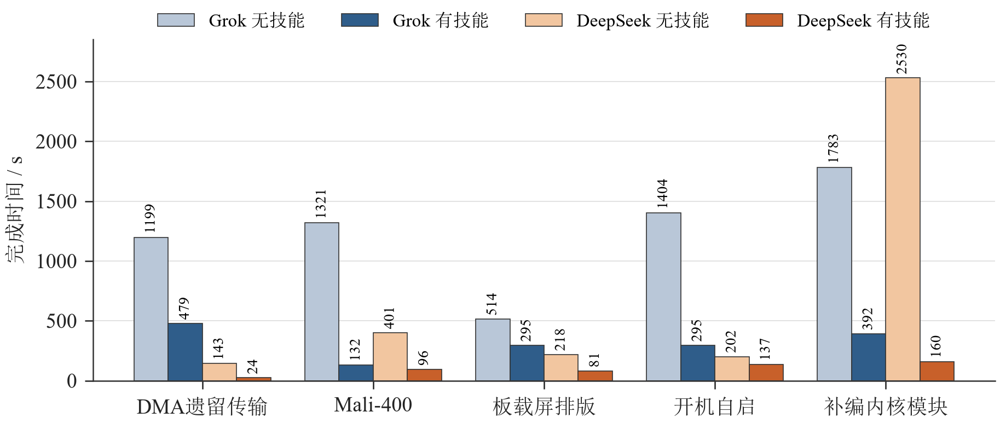

图B-1　有无技能的完成时间。

1. 有技能时各场景都更快（1.5～16倍），技能直接给出了根因、做法和可用的脚本；无技能时修复也常不完整，例如DMA修复缺接收超时或缺启动时复位。
2. 差别最大的是安全。无技能的代理大多未经询问就改动系统：安装软件包、加载内核模块并设为开机加载、安装并启用服务、为验证自启而自行重启板子、在系统内核构建树中重跑kconfig并改写配置，还有一次在SSH断开时尝试用默认密码登录Jupyter；有技能的运行都在暂停点停下。

技能内容与测试记录见`skill/README.md`。

## 附录C复现说明

硬件：2块PYNQ-ZU、2块AD-FMCOMMS3-EBZ、2根915 MHz天线；TX可选USB UVC摄像头，RX接1024×600 DisplayPort触摸屏；两板之间一根网线。

使用部署版比特流：见仓库根目录`README.md`。把`board/bitstreams/`与`src/sw/`拷到两块板上，安装`src/sw/systemd/`中的服务，上电约1分钟后触摸屏显示GUI。比特流的SHA-256见`board/bitstreams/SHA256SUMS`。Mali-400驱动与PyQt5的安装见`src/sw/board_setup/`。

从源码构建比特流（Vivado 2025.2）：

```
vivado -mode batch -source build/build_hw.tcl -tclargs tx 8
vivado -mode batch -source build/build_hw.tcl -tclargs rx 8
```

脚本按`src/hw/<tx|rx>/files.txt`新建工程、加入IP、生成PS块设计，用默认策略完成综合与实现。在干净目录中重建的资源与时序报告与部署版一致（表3-1）。

从模型重新生成神经网络：仓库中带有部署模型的检查点与W8A12量化导出（`data/model/`），`python src/network/regen_hw.py`由它重新生成两端的神经网络RTL与权重初始化文件并写入`src/hw/`，`git diff`为空即与入库文件一致。重新训练与导出见`src/model/README.md`，需要CUDA与训练数据。

仿真：`python sim/network/make_golden.py`用NumPy整数参考模型生成各层参考数据，再运行`sim/network/`中的脚本做单层、块级与整网的逐比特比对；SSCC基线的仿真见`sim/sscc/`。各脚本的命令与期望结果见`sim/README.md`。

复现测量：`board/tests/`中各脚本开头有用法说明。PSNR–SNR：RX板上运行`measure_link.py`，PC上运行`analyze_const.py`计算数据辅助SNR；帧率：`measure_link.py --src video --dwell 600`；分段时延：两板同时运行`pl_events.py`，PC上用`seg_latency.py`配对。报告中的图由`report/figures/visio/`（Visio脚本）与`report/figures/sim/`（Python脚本，实测数据图为`meas_plots.py`）生成。
